# Wall of Content – Anleitung

Diese Anleitung erklärt, wie du die Wall of Content startest, einrichtest und während der Veranstaltung bedienst.

**Inhalt**

1. [Was gehört dazu?](#1-was-gehört-dazu)
2. [Installieren und starten](#2-installieren-und-starten)
3. [Anmelden im Admin-Panel und Benutzer](#3-anmelden-im-admin-panel-und-benutzer)
4. [Die Wall](#4-die-wall)
5. [Inhalte, Hintergründe und Rahmen](#5-inhalte-hintergründe-und-rahmen)
6. [Fotostation](#6-fotostation)
7. [Color Hunt](#7-color-hunt)
8. [Quiz auf dem iPad](#8-quiz-auf-dem-ipad)
9. [Besucher-App: Programm, Challenges, Merch-Shop, Feedback](#9-besucher-app-programm-challenges-merch-shop-feedback)
10. [Verbund-Wall aus mehreren iPads (experimentell)](#10-verbund-wall-aus-mehreren-ipads-experimentell)
11. [Einstellungen](#11-einstellungen)
12. [Checkliste für den Veranstaltungstag](#12-checkliste-für-den-veranstaltungstag)
13. [Probleme und Lösungen](#13-probleme-und-lösungen)
14. [Show-Modus: alles Wichtige auf einen Blick](#14-show-modus-alles-wichtige-auf-einen-blick)
15. [Paket teilen: alles in einer ZIP-Datei](#15-paket-teilen-alles-in-einer-zip-datei)
16. [DVD-Logo (Bildschirmschoner)](#16-dvd-logo-bildschirmschoner)
17. [Vollbild](#17-vollbild)
18. [Bühne: Playlist und „Alle Inhalte“](#18-bühne-playlist-und-alle-inhalte)
19. [Live-Modus: Moments der Redaktion](#19-live-modus-moments-der-redaktion)
20. [Daten, Updates und Sicherung](#20-daten-updates-und-sicherung)
21. [Läuft gerade: Songtitel mit Schallplatte](#21-läuft-gerade-songtitel-mit-schallplatte)
22. [Livestream aus OBS auf der Wall](#22-livestream-aus-obs-auf-der-wall)

---

## 1. Was gehört dazu?

Ein Laptop ist der **Server**. Alle anderen Geräte öffnen nur eine Adresse im Browser – Apps müssen nicht installiert werden.

| Gerät | Adresse | Wofür |
|---|---|---|
| Großer Bildschirm / Beamer | `http://<laptop-ip>:3000/` | Die **Wall** mit schwebenden Bildern und Videos |
| Handy oder Tablet an der Fotostation | `https://<laptop-ip>:3443/station` | **Fotostation**: Rahmen wählen, Foto machen, QR-Code |
| iPad für Kinder | `http://<laptop-ip>:3000/quiz` | **Quiz** – zeigt die Wall, solange kein Quiz läuft |
| Handys der Gäste | `http://<laptop-ip>:3000/app` | **Besucher-App**: Live-Programm, Challenges, Merch-Shop, Feedback |
| Handys der Gäste | `http://<laptop-ip>:3000/hunt` | **Color Hunt** (Gäste scannen den QR-Code auf der Wall) |
| Mehrere iPads nebeneinander | `http://<laptop-ip>:3000/?pos=1`, `?pos=2`, … | **Verbund-Wall** (experimentell) |
| Dein Laptop/Handy | `http://<laptop-ip>:3000/admin` | **Admin-Panel** zum Steuern |

`<laptop-ip>` ist die Adresse des Laptops im WLAN, z. B. `192.168.1.10`. Sie steht nach dem Start im Terminal, und im
Admin-Panel unter **Übersicht** gibt es zu jeder Adresse einen QR-Code.

> **Wichtig:** Alle Geräte müssen im **selben WLAN** sein wie der Laptop.

---

## 2. Installieren und starten

> **Mac?** Am einfachsten geht es mit dem Startskript zum Doppelklicken – ohne etwas zu installieren.
> Alles dazu steht in der [Mac-Anleitung](MAC.md).

Für den Start über das Terminal (Windows, Linux oder Mac) wird einmalig [Node.js](https://nodejs.org) (Version 18 oder neuer) gebraucht.

**Code holen** – entweder als ZIP herunterladen und entpacken
([Download](https://github.com/theD-Creator/Wall-of-Content/archive/refs/heads/claude/wall-of-content-photo-stations-blixdl.zip))
oder mit Git:

```bash
git clone https://github.com/theD-Creator/Wall-of-Content.git
```

```bash
cd Wall-of-Content
```

```bash
git checkout claude/wall-of-content-photo-stations-blixdl
```

**Abhängigkeiten installieren** (nur beim ersten Mal und nach Updates):

```bash
npm install
```

**Starten:**

```bash
npm start
```

Im Terminal erscheint dann zum Beispiel:

```
  Wall of Content läuft

  Wall (Bildschirm):   http://localhost:3000/        (im Netzwerk: http://192.168.1.10:3000/)
  Fotostation (Handy): https://192.168.1.10:3443/station
  Admin-Panel:         http://localhost:3000/admin   (im Netzwerk: http://192.168.1.10:3000/admin)
  Color Hunt (Gäste):  http://192.168.1.10:3000/hunt
  Quiz (iPad):         http://192.168.1.10:3000/quiz

  Anmeldung im Admin-Panel als David R. (Global Admin)
  Passwort:            Ab3xY7kQ9zLm   (Startpasswort, steht auch in /Users/…/Wall of Content Daten/admin-password.txt)
  Daten:               /Users/…/Wall of Content Daten
```

Beenden mit `Strg + C`. Alle Fotos, Einstellungen, Benutzer und Ranglisten bleiben im Ordner **„Wall of Content Daten“**
in deinem Benutzerordner erhalten – auch wenn du eine neue Version herunterlädst (siehe [Daten, Updates und Sicherung](#20-daten-updates-und-sicherung)).

**Updates einspielen:**

```bash
git pull
```

```bash
npm install
```

Danach wieder `npm start`. Lädst du stattdessen eine neue Version als ZIP herunter, findet sie deine Daten automatisch –
siehe [Daten, Updates und Sicherung](#20-daten-updates-und-sicherung).

---

## 3. Anmelden im Admin-Panel und Benutzer

Öffne `http://localhost:3000/admin`, tippe auf dein Profilbild und gib dein Passwort ein.

| Anmeldung (Design „Neu“) | Anmeldung (Design „Klassisch“) |
|---|---|
| 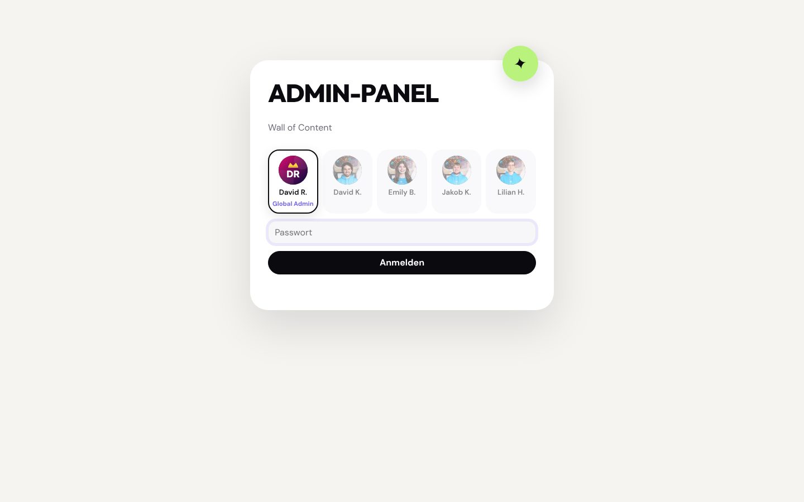 |  |

**Aufbau im neuen Design:** Links die Seitenleiste mit den Bereichen **Live** (Show, Übersicht), **Inhalte**,
**Mitmachen** (Color Hunt, Quiz, Programm, Challenges, Shop, Feedback), **Gestaltung** und **System**; rechts der
gewählte Bereich mit großer Überschrift. Oben rechts öffnet **„Wall öffnen ↗“** die Wall in einem neuen Tab.
Auf dem Handy wird die Seitenleiste zu einer Leiste oben zum Wischen.

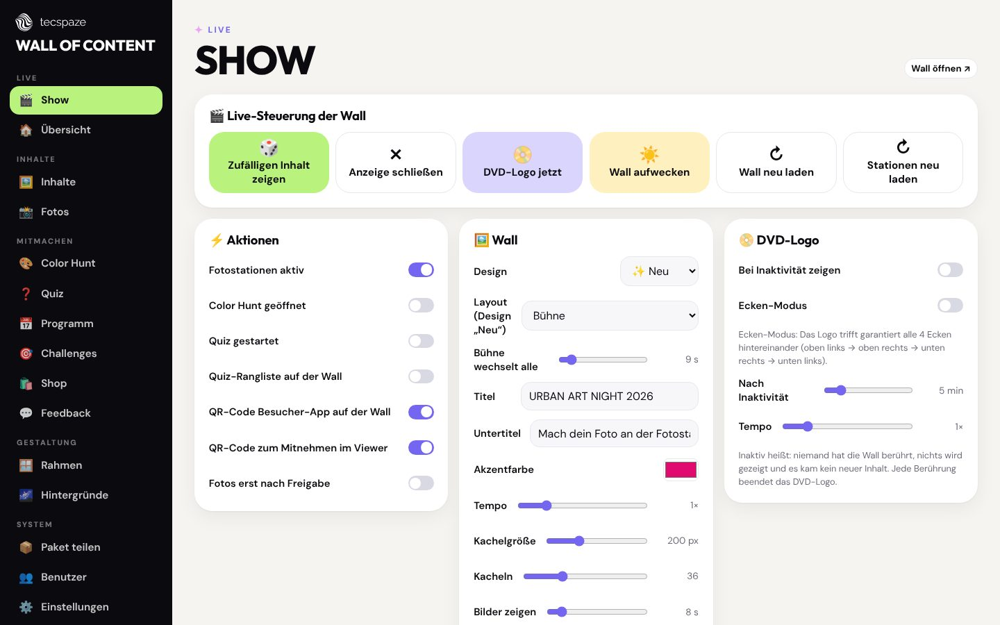

| Übersicht | Handy |
|---|---|
| 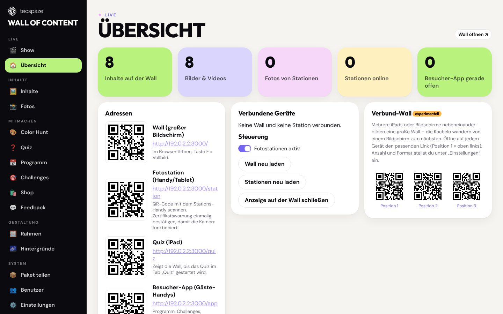 | 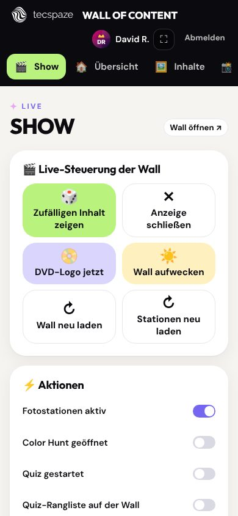 |

Es gibt fünf Benutzer:

| Benutzer | Rolle |
|---|---|
| **David R.** | Global Admin – darf zusätzlich Benutzer verwalten und Passwörter vergeben |
| David K., Emily B., Jakob K., Lilian H. | Admin – dürfen alles außer die Benutzerverwaltung |

**Erste Anmeldung:** Nur David R. hat am Anfang ein Passwort – das **Startpasswort** aus dem Terminal bzw. aus
`admin-password.txt` im Datenordner. Die anderen Benutzer sind ausgegraut, bis David R. ihnen ein Passwort gibt:

1. Als David R. anmelden und den Tab **Benutzer** öffnen.
2. Beim jeweiligen Benutzer ein Passwort (mind. 6 Zeichen) eintragen und auf **Festlegen** klicken.
3. Das Passwort der Person mitteilen. Sie kann es später unter **Einstellungen → Mein Passwort ändern** selbst ändern.


Im Tab **Benutzer** kann David R. außerdem Profilbilder ändern, neue Benutzer hinzufügen, die Rolle ändern und Benutzer
löschen. Neben **Admin** gibt es die Rolle **Redaktion**: Sie darf nur Moments mit der Live-Kamera posten (siehe
[Live-Modus](#19-live-modus-moments-der-redaktion)) und kommt nicht ins Admin-Panel.
Sobald David R. sein eigenes Passwort ändert, wird `admin-password.txt` gelöscht – das Startpasswort gilt dann nicht mehr.

**Passwort vergessen?** Den Server einmal so starten – dann gilt dieses Passwort für den Global Admin:

```bash
ADMIN_PASSWORD=neuesPasswort npm start
```

---

## 4. Die Wall

Die Wall läuft im Browser auf dem großen Bildschirm. Mit der Taste **F**, einem Doppelklick auf den Hintergrund
oder dem **⛶**-Knopf oben links geht sie in den Vollbildmodus (siehe [Vollbild](#17-vollbild)).

### Zwei Designs: „Neu“ und „Klassisch“

Unter **Einstellungen → Design** (oder im **Show-Modus**) wählst du das Design. Es gilt sofort für die Wall und das
Admin-Panel – niemand muss etwas neu laden.

| Design | Wall | Admin-Panel |
|---|---|---|
| **✨ Neu** (Standard) | **Schwebende Kacheln** (Standard), **Bühne**, **Mosaik** oder Bühne ⇄ Mosaik im Wechsel | hell, Seitenleiste mit Bereichen, große Überschriften |
| **Klassisch** | schwebende Kacheln im alten Look | dunkel, Reiter oben – wie bisher |

**Neues Admin-Panel, aber die bewährte Wall:** Design „Neu“ mit dem Layout **Schwebende Kacheln** (Show-Modus → Wall →
Layout). Die Kacheln schweben und stoßen sich ab wie immer, nur mit runden Ecken, den Schriften Outfit und DM Sans und den
Farben des neuen Designs.

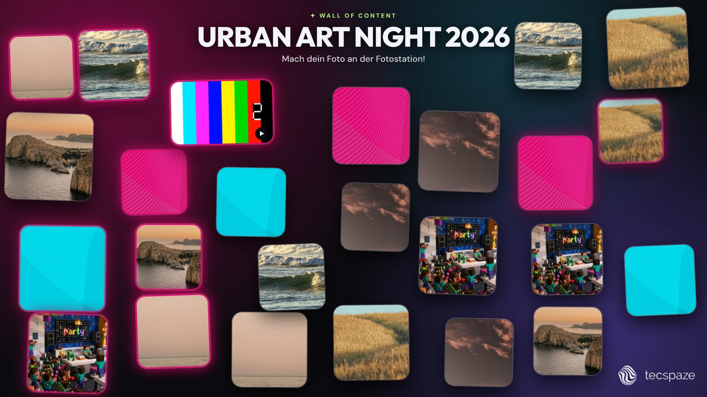

**Schneller:** Beim Zusammenstoß leuchten die Kacheln jetzt über eine eigene Ebene auf, die die Grafikkarte nur ein- und
ausblendet. Vorher wurden Schatten und Rahmen bei jedem Aufleuchten neu gezeichnet – das war fast die gesamte
Zeichenarbeit der Wall (gemessen: rund 1.500 statt jetzt etwa 12 Neuzeichnungen in 10 Sekunden). Das gilt für beide Designs.

Einzelne Geräte kannst du per Adresse umschalten, egal was eingestellt ist: `http://<laptop-ip>:3000/?design=klassisch`
bzw. `?design=neu` (geht auch beim Admin-Panel: `/admin?design=klassisch`).

Schriften im neuen Design: **Outfit** (fette Überschriften) und **DM Sans** (Text). Sie sind in der App enthalten und
funktionieren auch ohne Internet.

Das Design gilt auch für die **Besucher-App, Fotostation, Color Hunt, Quiz** sowie die Download- und Einlöse-Seite:
dunkel, große Überschriften, runde Buttons in Lime.

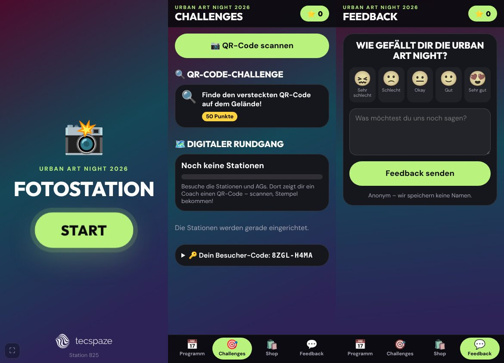

### Neues Design: Bühne

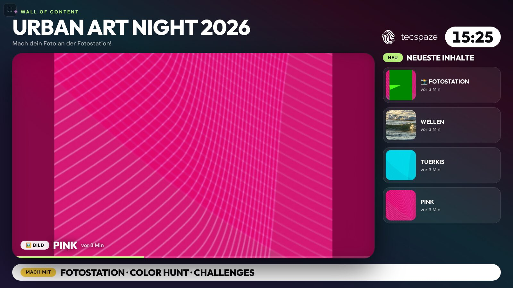

- **In der Mitte die Bühne:** ein Inhalt groß, alle paar Sekunden wechselt er sanft zum nächsten (einstellbar unter
  „Bühne wechselt alle“). Videos laufen stumm durch. **Antippen** öffnet den Inhalt groß – mit Ton.
- **Rechts „Neueste Inhalte“:** die sechs neuesten Bilder, Videos und Fotos. Ein neues Foto von der Fotostation springt
  sofort auf die Bühne und bekommt ein grünes **„Neu“**.
- **Unten das Band:** was laut Programm **jetzt live** läuft und was **gleich** kommt, rechts daneben die QR-Codes
  (Besucher-App, Color Hunt). Ohne Programm steht dort „Mach mit: Fotostation · Color Hunt · Challenges“.
- Oben Titel, Untertitel, Logo und Uhrzeit.

### Neues Design: Mosaik

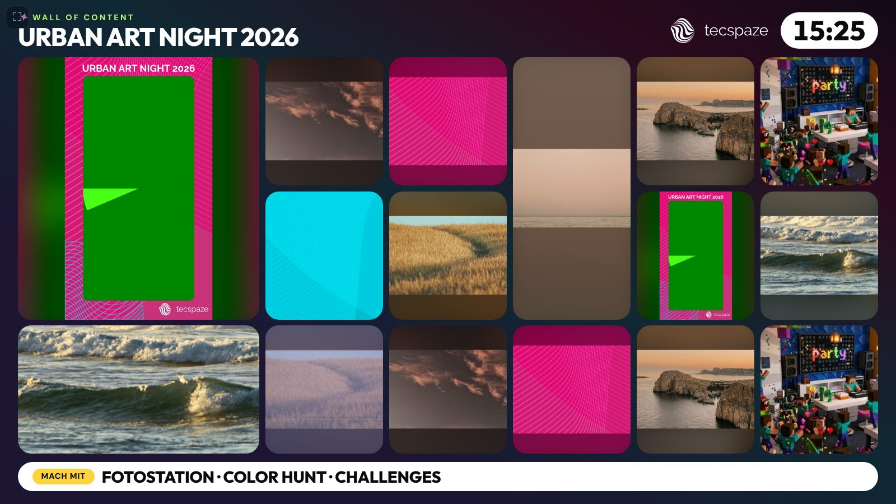

- Der ganze Bildschirm ist ein Raster aus großen und kleinen Kacheln. Alle drei Sekunden tauscht eine Kachel sanft ihren
  Inhalt, gut eine Minute später ordnet sich das Raster neu.
- Neue Fotos landen in den großen Kacheln und blinken kurz grün.
- Oben Titel, Logo und Uhrzeit, unten das Band mit „Jetzt live / Gleich“ und den QR-Codes. Nichts davon liegt über den
  Kacheln. Antippen öffnet groß.
- Passt ein Bild nicht zur Kachel (Panorama, sehr hohes Hochformat) oder ist die Datei klein, wird es **ganz** gezeigt –
  mit unscharfem Hintergrund – statt angeschnitten oder aufgeblasen.

**Kleine Dateien und Hochformat:** Kleine Bilder werden auf der Bühne und im Mosaik höchstens auf die doppelte Größe
vergrößert und sonst mittig gezeigt. Steht der Bildschirm hochkant (z. B. iPad im Hochformat) oder ist er schmal wie ein
Handy, rückt die Leiste „Neueste Inhalte“ als Reihe unter die Bühne. Es werden immer nur so viele Karten gezeigt, wie
ganz hineinpassen.

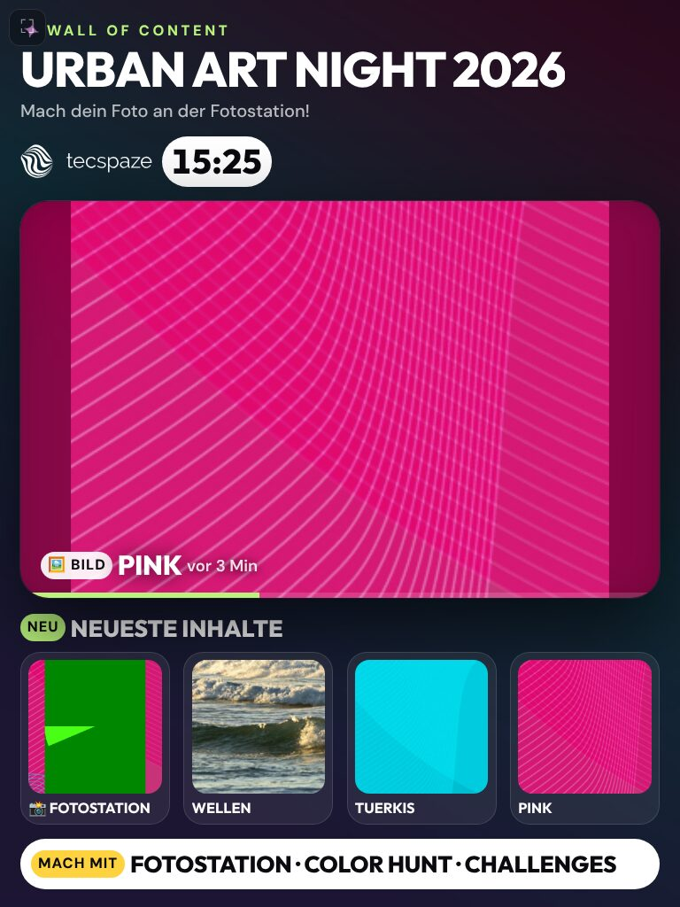

**Bühne ⇄ Mosaik im Wechsel:** wechselt automatisch zwischen beiden Layouts (Standard alle 4 Minuten, einstellbar).

Auch im neuen Design gilt: Ein Inhalt öffnet sich **groß über der Wall nur durch Antippen** oder per „Jetzt zeigen“ /
„Zufälligen Inhalt zeigen“ im Admin-Panel – die Bühne und das Mosaik wechseln nur innerhalb ihrer Fläche.

### Klassisches Design: schwebende Kacheln

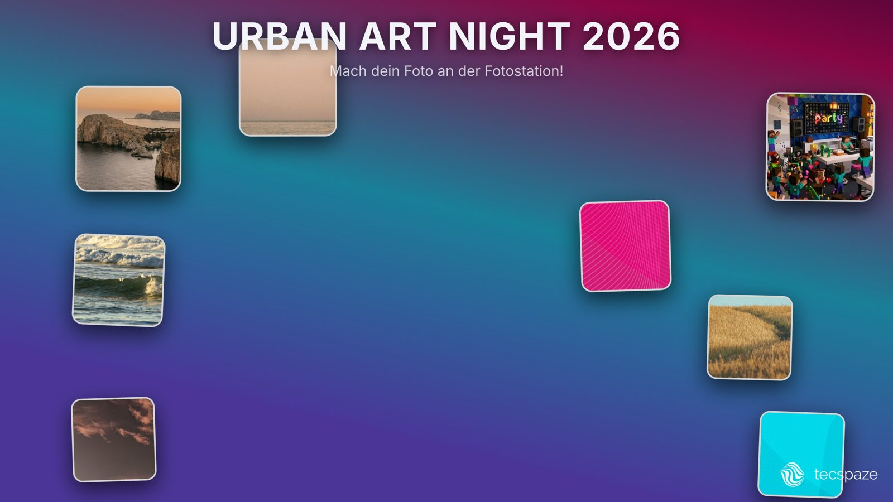

- Bilder und Videos schweben als Kacheln herum. Berühren sich zwei Kacheln, prallen sie voneinander ab und leuchten kurz auf.
- **Nur wer auf eine Kachel tippt oder klickt**, öffnet das Bild bzw. Video. Von selbst öffnet sich nichts.
  Mit **„Jetzt zeigen“** im Admin-Panel kannst du einen Inhalt gezielt öffnen.
- Neue Fotos von der Fotostation erscheinen sofort mit einer „NEU“-Animation.
- **Titel, Untertitel, QR-Codes, Logo und Rangliste haben eine Hitbox:** Kacheln prallen daran ab und schieben sich nie
  darunter. Beim Text zählt nur die tatsächliche Schrift (Zeile für Zeile), nicht der ganze Kopfbereich.
- **Vorladen:** Bilder und Videos der Kacheln werden im Hintergrund geladen – beim Antippen starten sie sofort.
  Abschaltbar im Show-Modus („Inhalte vorab laden“).
- Ein geöffneter Inhalt zeigt unten rechts einen kleinen **QR-Code zum Mitnehmen** – Gäste scannen ihn und laden das
  Bild/Video auf ihr Handy. Abschaltbar im Show-Modus.
- Während ein Inhalt groß gezeigt wird, stehen die Kacheln dahinter still, damit Videos flüssig laufen.
- Kann der Browser ein Video nicht abspielen (meist HEVC/H.265 aus dem iPhone), erscheint ein Hinweis statt eines
  schwarzen Bildes. Videos am besten als **MP4 (H.264)** hochladen.

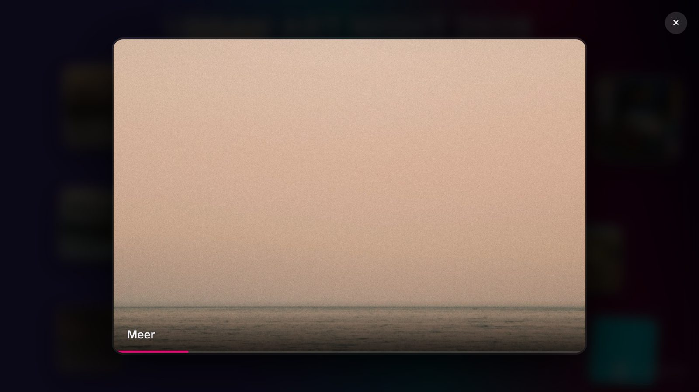

Läuft gerade ein Color Hunt, erscheint unten links ein kompakter QR-Code (mit Besucher-App-QR nebeneinander, Größe im
Show-Modus unter „QR-Größe“ einstellbar); ist die Quiz-Rangliste eingeschaltet, steht sie oben rechts:


---

## 5. Inhalte, Hintergründe und Rahmen

### Bilder und Videos für die Wall

Im Tab **Inhalte** Dateien hineinziehen oder auswählen (JPG, PNG, WebP, GIF, MP4, WebM, MOV). Jede Kachel lässt sich
ein-/ausblenden, betiteln, sofort zeigen oder löschen. Alternativ Dateien direkt in den Ordner `assets/media/` legen –
sie erscheinen automatisch.

Es gibt **keine feste Größengrenze** mehr – auch lange Videos lassen sich hochladen, solange auf dem Laptop Platz ist.
Ist die Festplatte voll, meldet das Admin-Panel das verständlich.

**Videos laufen in der Vorschau:** In der Inhaltsliste, in der Leiste der Bühne, im Mosaik und auf den schwebenden Kacheln
laufen Videos stumm als bewegte Vorschau – aber nur, solange sie sichtbar sind, und höchstens vier gleichzeitig (auf dem
iPad zwei), damit nichts ruckelt.

Fehlende Vorschaubilder (z. B. für Dateien aus `assets/media/`) erzeugt das Admin-Panel automatisch, sobald es geöffnet
ist. Mit **📤 Teilen** bekommst du für jeden Inhalt auf der Wall und jedes Foto einen QR-Code und Link zur Download-Seite.

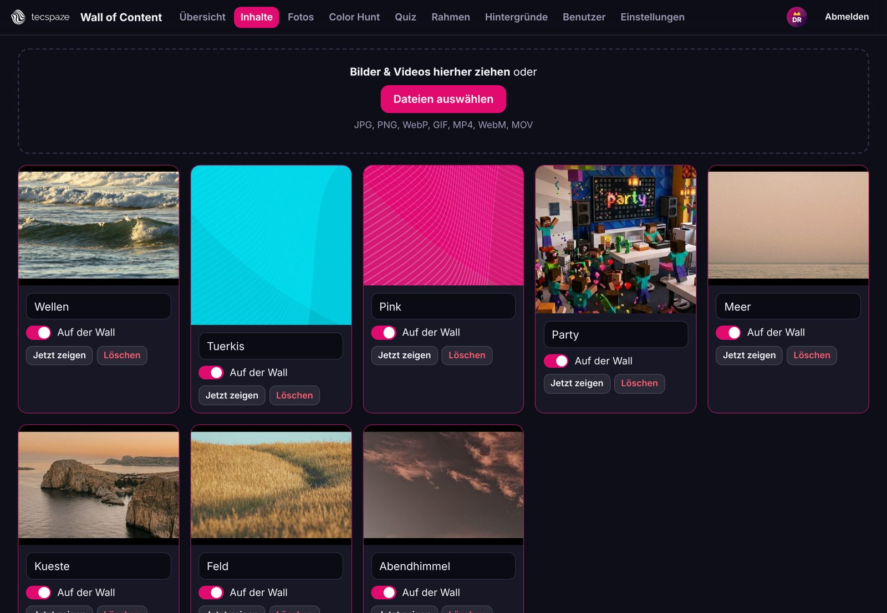

### Hintergrund – auch als animiertes Video

Im Tab **Hintergründe** ein Bild **oder ein Video** (MP4 oder WebM) hochladen und auf **Verwenden** klicken.
Videos laufen stumm in Endlosschleife hinter der Wall, der Fotostation und dem Quiz. Ein kurzes, ruhiges Video
(10–30 Sekunden, Full HD) funktioniert am besten.

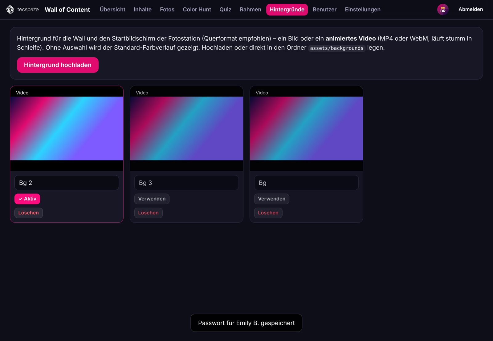

### Rahmen für die Fotostation

Im Tab **Rahmen** sind eure Event-Hintergründe hinterlegt. Das Foto wird in das abgerundete Fenster in der Mitte gesetzt.
Rahmen lassen sich ein-/ausschalten, umbenennen und neu hochladen (am besten 1080 × 1920 px, Vorlage:
`docs/foto-layout.png`). Bilder mit Transparenz (PNG) werden stattdessen über das Foto gelegt.


---

## 6. Fotostation

Das Handy oder Tablet an der Fotostation öffnet `https://<laptop-ip>:3443/station`.

> Beim ersten Öffnen erscheint eine **Zertifikatswarnung**. Einmal bestätigen („Erweitert“ → „Trotzdem fortfahren“) –
> sonst gibt der Browser die Kamera nicht frei. Mit `?name=Eingang` am Ende der Adresse bekommt die Station einen Namen.

| 1. Start | 2. Rahmen wählen | 3. Kontrolle | 4. QR-Code |
|---|---|---|---|
|  |  | 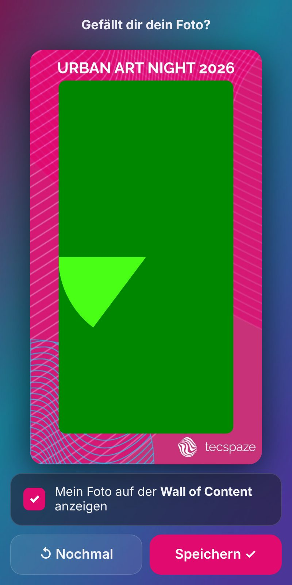 |  |

1. **Start** antippen.
2. Rahmen auswählen, Auslöser drücken – nach dem Countdown wird das Foto gemacht.
3. Foto prüfen. Der Haken **„Mein Foto auf der Wall of Content anzeigen“** entscheidet, ob es auf der Wall erscheint.
4. Mit dem QR-Code lädt der Gast das Foto auf sein eigenes Handy herunter.

Alle Fotos findest du im Tab **Fotos**. Fotos ohne Haken können nicht auf die Wall gelegt werden.
Mit „Moderation“ (Einstellungen) erscheinen Fotos erst nach deiner Freigabe.


---

## 7. Color Hunt

Gäste suchen mit dem eigenen Handy Dinge in einer bestimmten Farbe.

1. Im Tab **Color Hunt** den Schalter **„Geöffnet“** einschalten – auf der Wall erscheint ein QR-Code.
2. Gäste scannen ihn, geben ihren **Namen** ein und bekommen eine **Farbe**.
3. Nach der **Anleitung** startet mit „Start“ die Zeit: **5 Minuten** für **5 Fotos** in ihrer Farbe.
4. Danach tippen sie auf **Abgeben** – spätestens wenn die Zeit abläuft, wird automatisch abgegeben.
5. Jede Person kann **nur einmal** mitmachen (pro Handy und pro Name).

| Name | Farbe | Anleitung | Fotos |
|---|---|---|---|
| 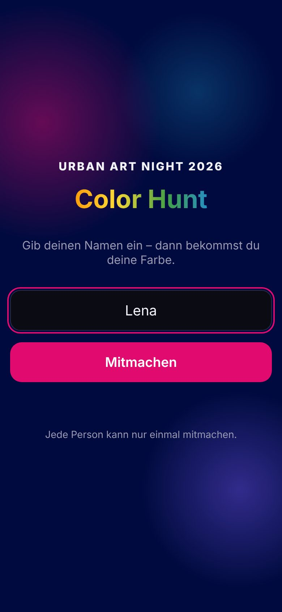 | 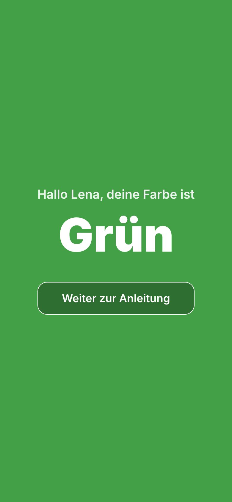 | 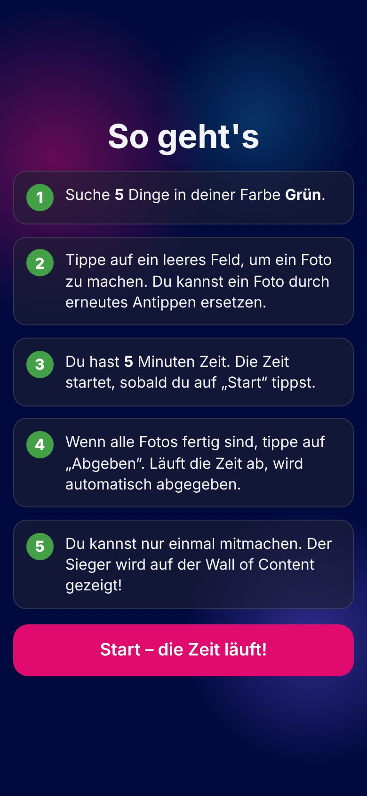 | 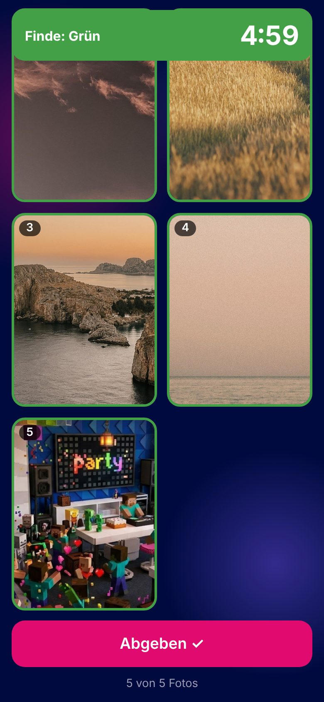 |

### Countdown für die ganze Challenge

Im Tab **Color Hunt** kannst du festlegen, wie lange die Challenge insgesamt noch läuft:

1. Minuten eintragen (z. B. `30`) und auf **Countdown starten** klicken – der Color Hunt öffnet sich dabei automatisch.
2. Mit **+5 Min** / **−5 Min** verlängerst oder verkürzt du jederzeit, **Countdown stoppen** entfernt ihn (die Challenge bleibt offen).
3. Die Restzeit läuft auf der **Wall** im QR-Kasten mit, die **letzten 10 Sekunden** erscheinen groß in der Mitte, danach „Zeit ist um!“.
4. Auch auf den **Handys der Gäste** steht „Die Challenge endet in …“. Wer kurz vor Schluss startet, hat nur noch die Restzeit
   statt der vollen 5 Minuten.
5. Ist der Countdown abgelaufen, **schließt der Color Hunt automatisch**: keine neuen Anmeldungen mehr, und alle, die gerade
   noch fotografieren, geben automatisch ab. Danach kannst du in Ruhe den Sieger wählen.


| Wall mit Countdown | Die letzten Sekunden | Handy des Gastes |
|---|---|---|
| 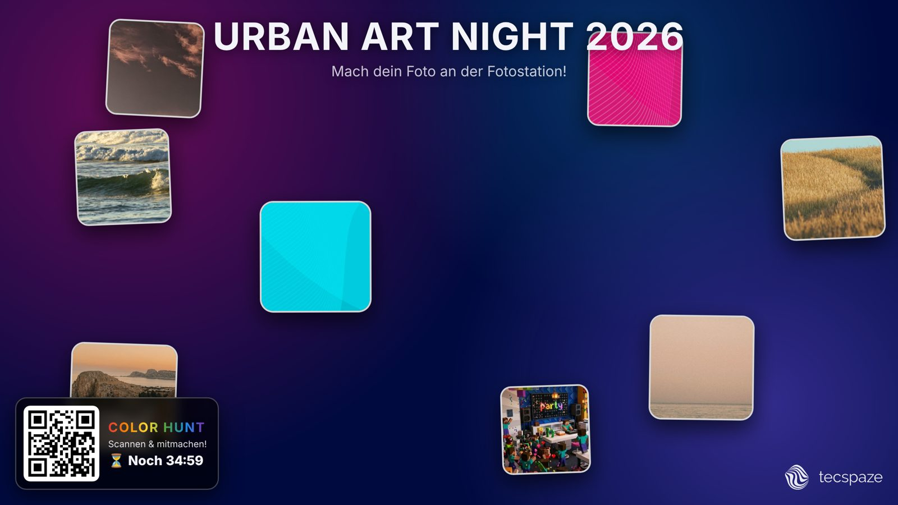 |  |  |

### Teilnehmer und Sieger

Im Admin-Panel siehst du alle Teilnehmer live – mit Farbe, Restzeit und Fotos. Mit **„Als Sieger wählen“** erscheint der
Sieger sofort groß auf der Wall, bis du ihn mit **„Auf der Wall ausblenden“** wieder wegnimmst.
**„Neue Runde“** löscht alle Teilnehmer und Fotos.


---

## 8. Quiz auf dem iPad

Ein Quiz für Kinder mit Rangliste. Das iPad öffnet `http://<laptop-ip>:3000/quiz`.

**Solange das Quiz nicht gestartet ist, zeigt das iPad einfach die Wall of Content.** Sobald du im Tab **Quiz** den Schalter
**„Quiz gestartet“** einschaltest, wechselt das iPad automatisch zum Quiz – und beim Ausschalten wieder zurück zur Wall.

| Startbildschirm | Name eingeben |
|---|---|
|  | 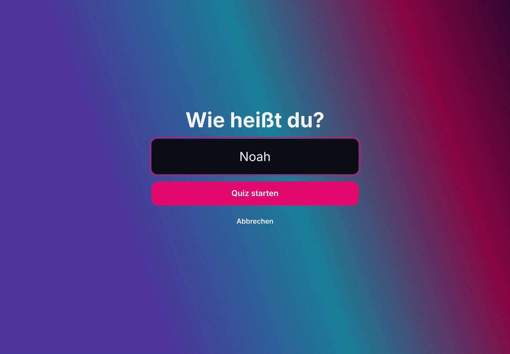 |

| Frage | Auflösung |
|---|---|
|  | 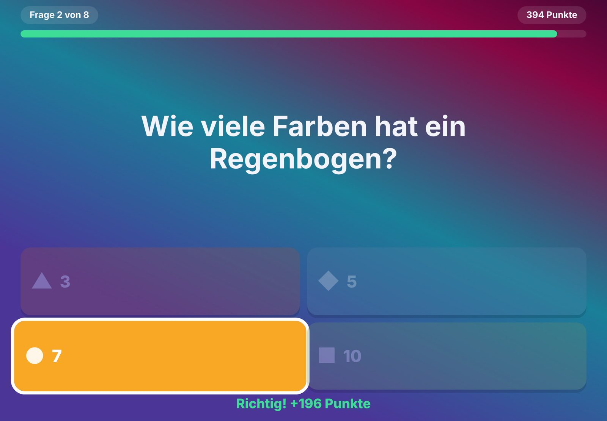 |

- Jede Runde hat **8 zufällige Fragen** mit je **20 Sekunden** (einstellbar unter Einstellungen → Quiz).
- Richtige Antworten geben **100 Punkte plus bis zu 100 Bonuspunkte**, je schneller, desto mehr.
- Am Ende sieht das Kind seine Punkte, seinen Platz und die **Rangliste**. Nach 30 Sekunden geht es automatisch zurück zum Start.


Im Tab **Quiz** kannst du:

- das Quiz starten und stoppen,
- die **Rangliste auf der Wall** einblenden,
- Fragen hinzufügen, bearbeiten und löschen (2–4 Antworten, die richtige mit dem Punkt markieren),
- einzelne Einträge oder die ganze Rangliste löschen.


**Tipps für das iPad:**

- Adresse in Safari öffnen, dann **Teilen → „Zum Home-Bildschirm“** – so läuft das Quiz ohne Adressleiste im Vollbild.
- Unter **Einstellungen → Bedienungshilfen → Geführter Zugriff** das iPad auf diese App sperren, damit Kinder sie nicht verlassen.
- Automatische Sperre ausschalten (Einstellungen → Anzeige & Helligkeit → Automatische Sperre → Nie) und das iPad am Strom lassen.

---

## 9. Besucher-App: Programm, Challenges, Merch-Shop, Feedback

Die **Besucher-App** läuft auf den Handys der Gäste unter `http://<laptop-ip>:3000/app` – ohne Installation und ohne
Anmeldung. Unten gibt es vier Bereiche: **Programm**, **Challenges**, **Shop** und **Feedback**; oben steht immer der
Punktestand.

- Den QR-Code zur App findest du im Admin-Panel im Tab **Programm**. Mit dem Schalter **„QR-Code zur Besucher-App auf der
  Wall zeigen“** erscheint er unten links auf der Wall (über dem Color-Hunt-Code, falls der gerade läuft).
- Jeder Gast bekommt beim ersten Öffnen automatisch ein **anonymes Profil** auf seinem Handy. Daran hängen Punkte, Stempel,
  Coupons und Feedback – Namen werden nicht gespeichert.
- Unter **Challenges → „Dein Besucher-Code“** steht ein Code wie `U7QS-AWF3`. Damit nimmt man seinen Fortschritt auf ein
  anderes Handy oder in einen anderen Browser mit (z. B. wenn der Akku leer ist).
- Alles, was ihr im Admin-Panel ändert, erscheint **sofort** auf allen Handys – niemand muss neu laden.

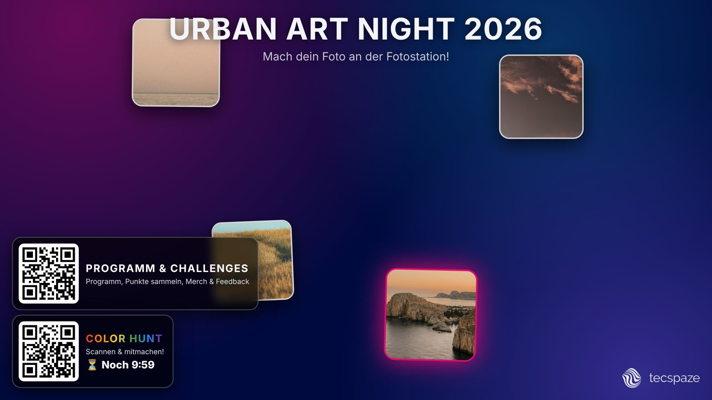

### Live-Programm

**Einrichten (Tab „Programm“):** Titel, kurze Beschreibung, Datum, Beginn und Ende eintragen, optional
**★ Als Highlight hervorheben**, speichern. Mit ▲ ▼ legst du die Reihenfolge fest, **„Nach Uhrzeit sortieren“** ordnet
alles automatisch. Programmpunkte lassen sich jederzeit bearbeiten und löschen.


**Für die Gäste:** Oben steht groß, was **jetzt live** läuft (mit Restzeit) bzw. was **als Nächstes** kommt. In der
Liste ist der laufende Punkt pink markiert und mit Fortschrittsbalken versehen, der nächste trägt „Gleich“, vergangene
sind ausgegraut und durchgestrichen. Das aktualisiert sich automatisch anhand der Uhrzeit.

| Programm | Challenges | Stempel erhalten |
|---|---|---|
| 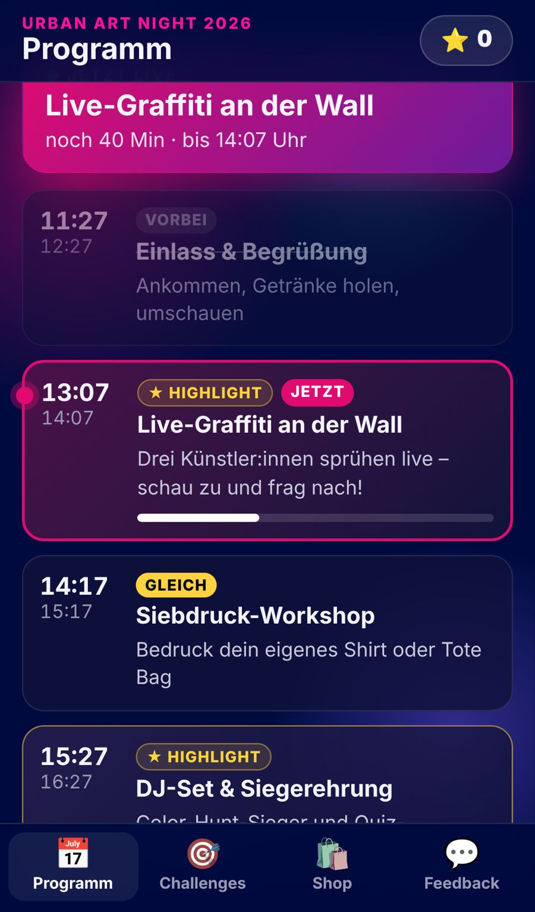 | 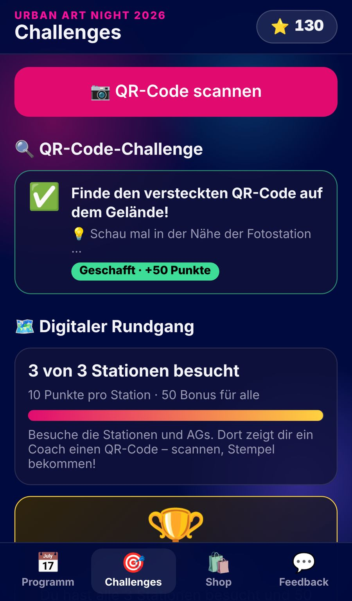 | 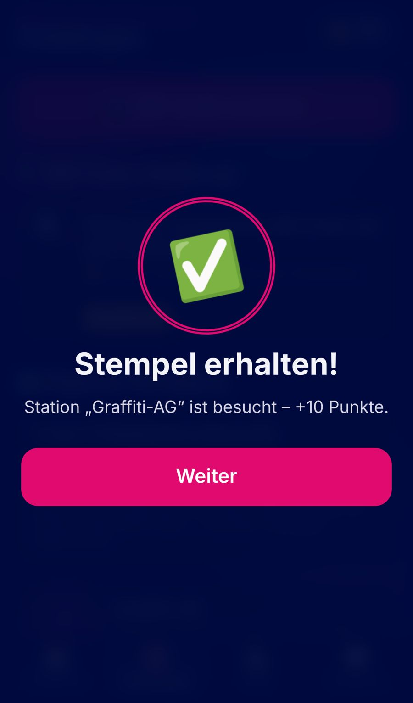 |

### Challenges – QR-Code-Challenge (Schatzsuche)

Es gibt bereits eine Challenge **„Finde den versteckten QR-Code auf dem Gelände!“**.

1. Im Tab **Challenges** auf **🖨️ Drucken** klicken (oder **⬇️ PNG** herunterladen), ausdrucken und auf dem Gelände verstecken.
2. Optional einen **Tipp** und die **Punkte** festlegen (Standard: 50). Weitere Challenges kannst du unten hinzufügen,
   mit dem Schalter **Aktiv** pausierst du eine.
3. Wer den Code findet, scannt ihn – mit der **Kamera-App** des Handys oder in der Besucher-App mit **„📷 QR-Code scannen“**.
   Die Challenge wird abgehakt und die Punkte gutgeschrieben.

**Sicherheit:** Jeder QR-Code enthält einen eigenen, nicht erratbaren Schlüssel. Ein beliebiger anderer QR-Code wird
abgelehnt („Unbekannter QR-Code“), und jede Challenge zählt pro Person nur **einmal**. Ist ein Foto des Codes im Umlauf,
macht **„Neuer Code“** den alten Ausdruck ungültig – danach neu ausdrucken.

### Challenges – Digitaler Rundgang mit Stempeln

1. Im Tab **Challenges** unter **Digitaler Rundgang** jede Station bzw. AG mit **Name** und **Beschreibung** anlegen.
2. **🖨️ Alle Stations-Codes drucken** – pro Station eine A4-Seite mit großem QR-Code. Alternativ einzeln drucken oder als PNG
   aufs Handy des Coaches laden.
3. An der Station zeigt der Coach den Code, der Gast scannt ihn → die Station bekommt einen **Stempel** und
   **10 Punkte** (einstellbar). Wer **alle** Stationen schafft, sieht eine Abschlussmeldung und bekommt **50 Bonuspunkte**
   (einstellbar).
4. Gäste sehen jederzeit ihren Fortschritt, z. B. „2 von 3 Stationen besucht“.


In der **Auswertung** siehst du, wie viele Besucher an jeder Station waren und wie viele den Rundgang komplett haben.


> **Scannen in der App:** Die Live-Kamera im Browser gibt es nur über HTTPS. Über die normale Adresse (`http://…:3000/app`)
> öffnet der Scanner stattdessen die Kamera für ein **Foto vom QR-Code** – das wird sofort ausgewertet. Am einfachsten
> ist ohnehin die **Kamera-App** des Handys: QR-Code scannen, Link antippen, fertig.


### Merch-Shop mit Coupons

**Einrichten (Tab „Shop“):** Artikel mit Name, Beschreibung, **Preis in Punkten**, optional **Bestand** (leer = unbegrenzt)
und Bild anlegen. Mit **„Im Shop sichtbar“** blendest du Artikel ein und aus.

**Für die Gäste:** Im Shop sehen sie ihre Punkte und alle Artikel. Reichen die Punkte, tippen sie auf **„Coupon holen“** –
die Punkte werden abgezogen und es erscheint ein **Coupon mit QR-Code und Code**. Alle Coupons stehen unter „Meine Coupons“.

| Shop | Coupon zum Vorzeigen | Nach dem Einlösen |
|---|---|---|
| 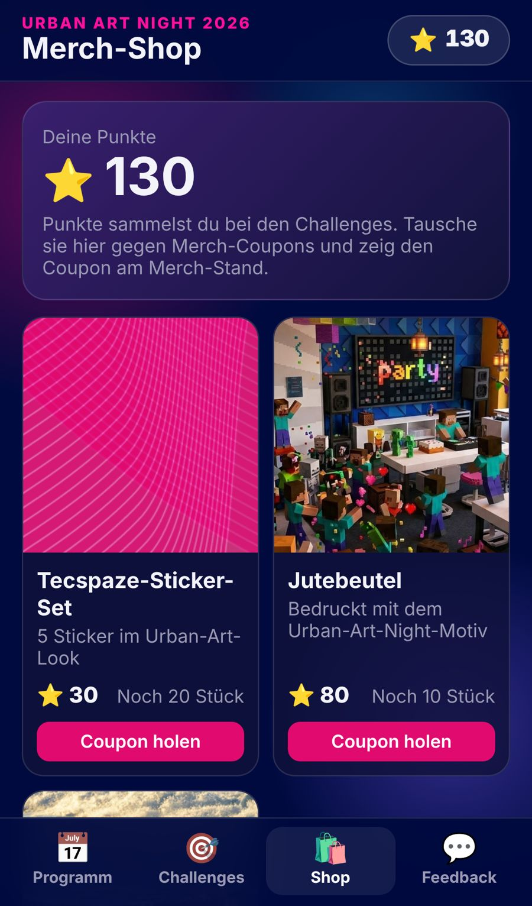 | 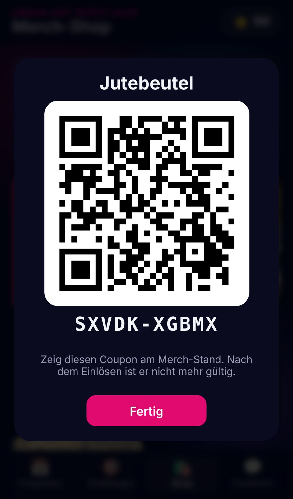 | 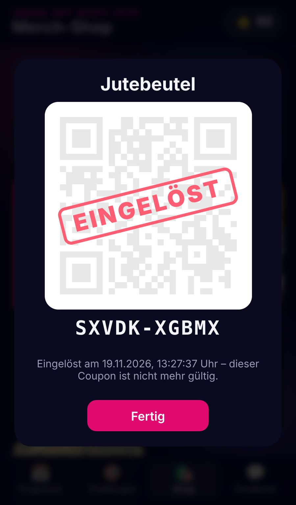 |

**Am Merch-Stand einlösen** – nur angemeldete Team-Mitglieder können einlösen:

- **Am schnellsten:** Den Coupon-QR-Code mit der **Kamera-App** eines Handys scannen, auf dem ihr im Admin-Panel angemeldet
  seid. Es öffnet sich die Einlöse-Seite → **„Jetzt einlösen“**.
- **Im Admin-Panel:** Tab **Shop → Coupon prüfen & einlösen**, Code eintippen oder **📷 Scannen**, dann **„Jetzt einlösen“**.

Danach ist der Coupon **gesperrt**: Auf dem Handy des Gastes steht sofort „EINGELÖST“, und ein zweiter Versuch zeigt
„Bereits eingelöst am … (Name)“. Ein noch nicht eingelöster Coupon kann **storniert** werden – die Punkte gehen zurück.

| Coupon prüfen im Admin-Panel | Einlöse-Seite: schon eingelöst |
|---|---|
|  | 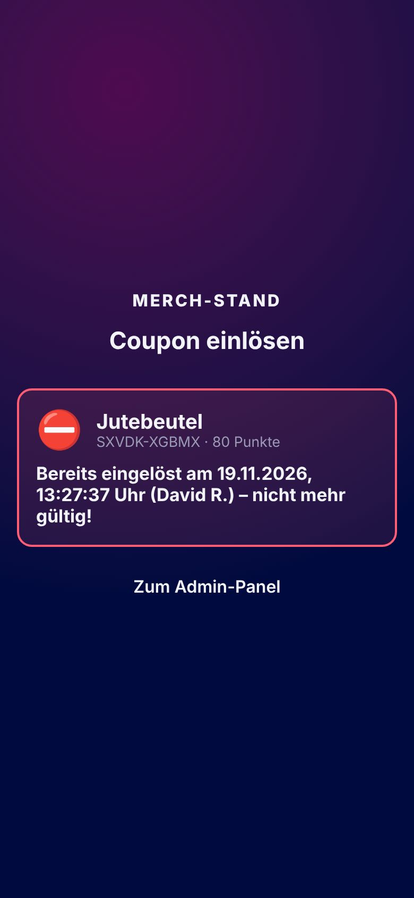 |


### Feedback

**Für die Gäste:** „Wie gefällt dir die Urban Art Night?“ – einen der fünf Smileys antippen, optional einen Text schreiben,
**„Feedback senden“**. Das Feedback ist **anonym**. Pro Handy gibt es **eine** Bewertung; wer nochmal sendet, ändert seine
bestehende Bewertung (so wird nichts doppelt gezählt).

| Feedback geben | Bestätigung |
|---|---|
|  |  |

**Auswertung (Tab „Feedback“):** Durchschnittsbewertung, Verteilung der Smileys als Diagramm und alle Texte. Sortieren
nach Datum oder Bewertung, filtern nach Smiley, „Nur mit Text“ und „Nur ungelesene“, als gelesen markieren, löschen und
**als CSV für Excel** herunterladen.

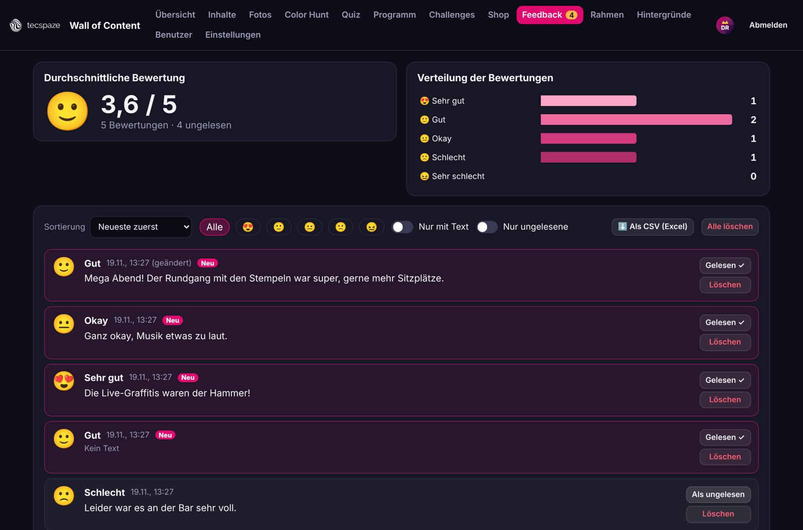

### Vor der Veranstaltung: Testdaten löschen

Nach dem Ausprobieren im Tab **Challenges → Zurücksetzen → „Fortschritt aller Besucher löschen“** klicken (löscht Profile,
Punkte, Stempel und Coupons – Stationen, Challenges und Artikel bleiben). Test-Feedback löscht ihr im Tab **Feedback**
mit **„Alle löschen“**.

---

## 10. Verbund-Wall aus mehreren iPads (experimentell)

Mehrere iPads (oder Bildschirme) nebeneinander bilden zusammen **eine große Wall**. Die Kacheln wandern dabei von einem
Bildschirm zum nächsten.

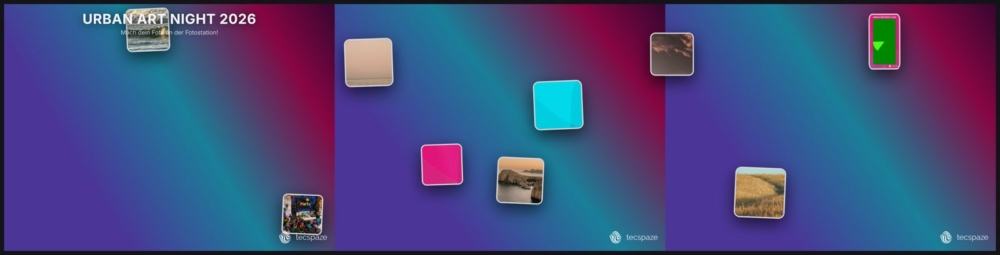

**So richtest du sie ein:**

1. Unter **Einstellungen → Verbund-Wall** eintragen, wie viele Bildschirme **nebeneinander** und **übereinander** stehen,
   und welches **Format** sie haben (iPad quer = 4:3). Speichern.
2. Unter **Übersicht → Verbund-Wall** erscheint für jede Position ein QR-Code. Position 1 ist **oben links**, dann geht es
   nach rechts und anschließend in die nächste Reihe.
3. Jedes iPad scannt seinen QR-Code bzw. öffnet `http://<laptop-ip>:3000/?pos=1`, `?pos=2`, `?pos=3` …
4. iPads in der richtigen Reihenfolge aufstellen.

**Gut zu wissen:**

- Titel, Color-Hunt-QR-Code und Rangliste erscheinen nur auf Position 1.
- Die Bewegung wird auf dem Laptop berechnet und ca. 10× pro Sekunde an alle iPads gesendet. Bei schwachem WLAN kann
  es ruckeln – ein eigener Router nur für die Veranstaltung hilft.
- Haben die Bildschirme unterschiedliche Größen, wird jeder Bildschirm auf das eingestellte Format eingepasst.
- Ein Quiz-iPad kann auch Teil der Verbund-Wall sein: `http://<laptop-ip>:3000/quiz?pos=2` zeigt außerhalb des Quiz
  den passenden Ausschnitt.
- Da diese Funktion experimentell ist, vor der Veranstaltung unbedingt einmal mit den echten Geräten ausprobieren.

---

## 11. Einstellungen

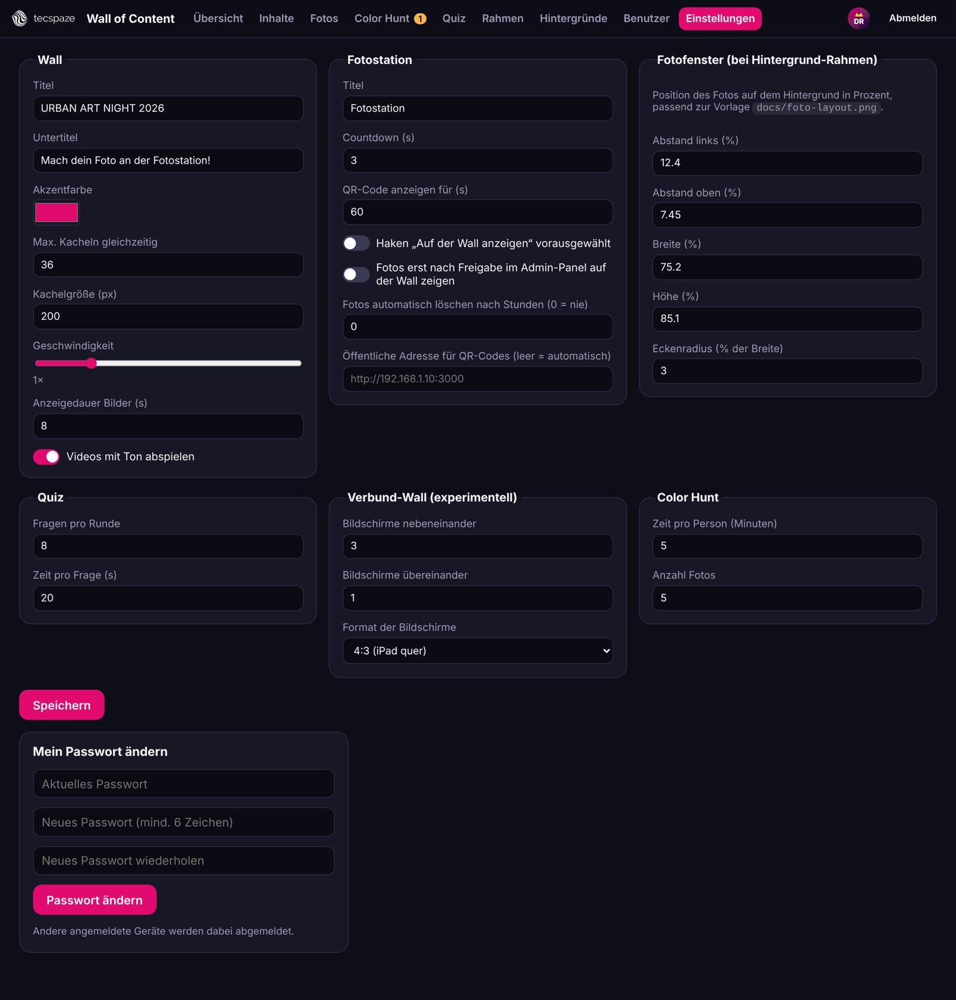

| Bereich | Was du einstellen kannst |
|---|---|
| Wall | Titel, Untertitel, Akzentfarbe, Anzahl/Größe/Geschwindigkeit der Kacheln, Anzeigedauer der Bilder, Ton bei Videos |
| Fotostation | Titel, Countdown, Dauer der QR-Anzeige, Haken vorausgewählt, Moderation, automatisches Löschen, Adresse für QR-Codes |
| Fotofenster | Position und Größe des Fotos auf den Event-Rahmen |
| Quiz | Fragen pro Runde, Zeit pro Frage |
| Verbund-Wall | Anzahl Bildschirme nebeneinander/übereinander, Format |
| Color Hunt | Zeit pro Person, Anzahl Fotos |
| Mein Passwort ändern | eigenes Passwort ändern |

Unter **Übersicht** siehst du alle Adressen mit QR-Codes, die verbundenen Geräte und kannst die Fotostationen pausieren,
die Wall oder Stationen neu laden und einen geöffneten Inhalt auf der Wall schließen.

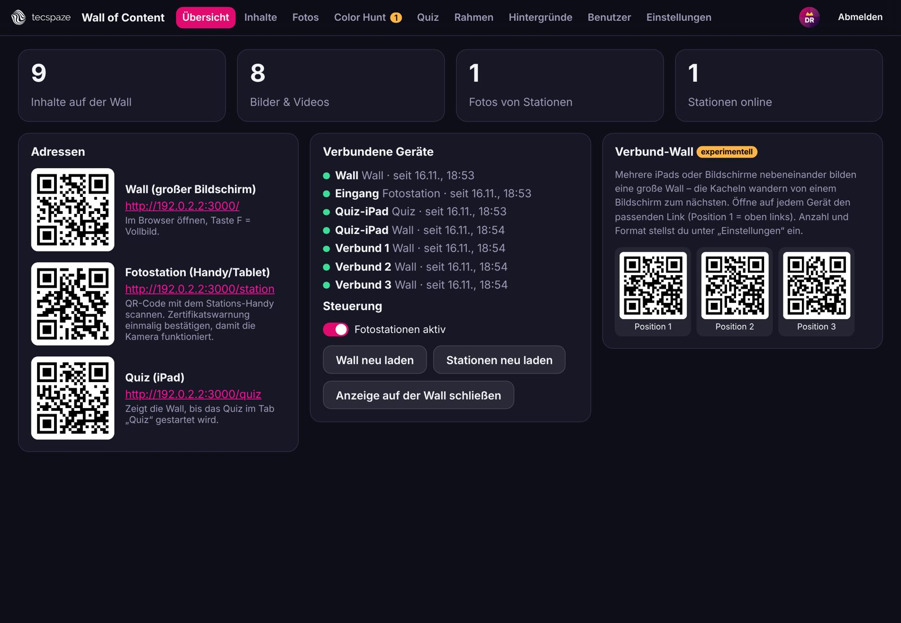

---

## 12. Checkliste für den Veranstaltungstag

1. Laptop ans Strom- und Event-WLAN, `npm start`.
2. Im Admin-Panel anmelden, **Übersicht** öffnen.
3. Wall auf dem großen Bildschirm öffnen, mit **F** in den Vollbildmodus. Im Tab **🎬 Show** prüfen: DVD-Logo an/aus, Tempo, QR-Größe.
4. Fotostation-Handy: QR-Code scannen, Zertifikat bestätigen, Kamera erlauben, Probefoto machen.
5. Quiz-iPad: Adresse öffnen (zeigt erst die Wall), Geführten Zugriff aktivieren.
6. Optional Verbund-iPads mit ihren Positionen öffnen.
7. Unter **Übersicht → Verbundene Geräte** prüfen, dass alles verbunden ist.
8. Besucher-App vorbereiten: Programm eintragen, Stations-Codes und den versteckten QR-Code ausdrucken und verteilen,
   Merch-Artikel anlegen, Testdaten löschen (Challenges → Zurücksetzen), QR-Code der Besucher-App auf der Wall einschalten.
9. Wenn es losgeht: Quiz starten, Color-Hunt-Countdown starten.

---

## 13. Probleme und Lösungen

| Problem | Lösung |
|---|---|
| Ein Gerät erreicht die Adresse nicht | Gleiches WLAN? Laptop-Firewall für Port 3000 und 3443 freigeben. |
| Fotostation zeigt keine Kamera | Adresse muss mit `https://` und Port `3443` beginnen; Zertifikatswarnung bestätigen; Kamera erlauben. Ohne Kamera-Freigabe öffnet der Auslöser die Kamera-App. |
| QR-Code zum Download funktioniert nicht | Einstellungen → „Öffentliche Adresse für QR-Codes“ auf `http://<laptop-ip>:3000` setzen. |
| Hintergrundvideo läuft nicht | MP4 (H.264) oder WebM verwenden; sehr große Dateien vorher verkleinern. |
| Video auf der Wall startet nicht / Hinweis „lässt sich hier nicht abspielen“ | Meist HEVC/H.265 (iPhone-Standard) oder ein exotisches MOV. Als MP4 (H.264) exportieren, z. B. iPhone: Einstellungen → Kamera → Formate → „Maximale Kompatibilität“. |
| Video startet stumm mit „Tippen für Ton“ | Browser erlauben Ton erst nach einer Berührung. Einmal auf die Wall tippen – danach läuft Ton (gilt bei „Jetzt zeigen“ aus dem Admin-Panel). |
| Paket: Empfänger kann sich nicht anmelden | Es gelten dieselben Passwörter wie beim Original. Galt dort noch das Startpasswort, steht es nicht im Paket – vorher ändern. Notfalls beim Empfänger `ADMIN_PASSWORD=neuesPasswort npm start`. |
| Paket: macOS blockiert Start-Mac.command | Wie beim ersten Start: Terminal öffnen, `bash ` tippen, Datei hineinziehen, Enter ([MAC.md](MAC.md)). |
| Paket: QR-Codes zeigen beim Empfänger auf die falsche Adresse | Die öffentliche Adresse wird im Paket geleert und automatisch neu ermittelt; sonst unter Einstellungen neu setzen. |
| Kein ⛶-Knopf zu sehen | Der Browser kann kein Vollbild (z. B. iPhone-Safari). Seite über „Teilen → Zum Home-Bildschirm“ hinzufügen – dann startet sie ohne Browserleiste. |
| Ein Gast hat seine Punkte „verloren“ | Anderer Browser oder Daten gelöscht? Mit dem Besucher-Code (Challenges → „Dein Besucher-Code“) wiederherstellen. |
| Scanner in der Besucher-App zeigt kein Livebild | Normal über `http://` – „Foto vom QR-Code machen“ oder die Kamera-App des Handys nutzen. |
| Coupon lässt sich nicht einlösen | Nur angemeldete Team-Mitglieder können einlösen; „Bereits eingelöst“ heißt: der Coupon wurde schon verwendet. |
| Benutzer kann sich nicht anmelden | David R. muss im Tab **Benutzer** zuerst ein Passwort festlegen. |
| Passwort vergessen | Server mit `ADMIN_PASSWORD=neuesPasswort npm start` starten (gilt für den Global Admin). |
| Alles zurücksetzen | Server stoppen, Ordner „Wall of Content Daten“ sichern (oder unter System → Sicherung herunterladen) und dann löschen, neu starten. |

---

## 14. Show-Modus: alles Wichtige auf einen Blick

Der Tab **🎬 Show** ist der erste Tab im Admin-Panel und für die laufende Veranstaltung gedacht. **Jede Änderung wirkt
sofort** – kein Speichern-Knopf nötig (ein kurzes grünes Aufleuchten bestätigt es).

| Bereich | Was geht |
|---|---|
| Live-Steuerung | Zufälligen Inhalt auf der Wall zeigen, Anzeige schließen, DVD-Logo sofort starten, Wall aufwecken, Wall/Stationen neu laden |
| Aktionen | Fotostationen, Color Hunt, Quiz, Quiz-Rangliste, QR-Code der Besucher-App, QR zum Mitnehmen, Freigabe-Pflicht – jeweils ein Schalter |
| Wall | Titel, Untertitel, Akzentfarbe, Tempo, Kachelgröße, Anzahl Kacheln, Anzeigedauer, QR-Größe, Ton, Vorladen |
| DVD-Logo | Bildschirmschoner an/aus, Ecken-Modus, Wartezeit, Tempo |
| Vollbild | „Vollbild beim ersten Antippen“ für Wall, Station, Quiz und Color Hunt |

Das Admin-Panel merkt sich den zuletzt geöffneten Tab.

---

## 15. Paket teilen: alles in einer ZIP-Datei

Mit **📦 Paket teilen** (Tab im Admin-Panel, nur für den Global Admin) gibst du die **komplette Wall of Content** weiter –
z. B. an ein anderes Team oder auf einen Ersatz-Laptop. Wer den Ordner öffnet, hat sofort alles: Inhalte, Fotos, Rahmen,
Hintergründe, Logo, Einstellungen, Benutzer mit ihren Passwörtern, Color Hunt, Quiz und die Besucher-App mit Programm,
Challenges, Shop und Feedback.

1. Tab **📦 Paket teilen** öffnen. Oben siehst du, was mitkommt und wie groß das Paket ungefähr wird.
2. Optional: **Fotos der Gäste mitnehmen** (Fotostation, Color Hunt) und **Node.js mitliefern** abwählen.
   Mit Node.js braucht der Empfänger kein Internet.
3. **„Paket erstellen & herunterladen“** – du bekommst `Wall-of-Content-<Datum>.zip`.
4. Weitergeben per AirDrop, USB-Stick oder Cloud.
5. Der Empfänger entpackt die ZIP (Doppelklick), öffnet den Ordner **Wall-of-Content** und doppelklickt
   **Start-Mac.command**. Anmeldung im Admin-Panel mit **denselben Benutzern und Passwörtern** wie bei dir.

**Was ist mit den Passwörtern?**

- Die Passwörter der Admin-Benutzer liegen nur als **scrypt-Hash** im Paket. Sie funktionieren beim Empfänger genauso,
  lassen sich aus den Dateien aber nicht zurückrechnen.
- **Nicht im Paket:** das Startpasswort im Klartext (`admin-password.txt`), der private HTTPS-Schlüssel und das Zertifikat
  (werden auf dem neuen Rechner neu erzeugt) und angemeldete Sitzungen.
- Gilt für den Global Admin noch das Startpasswort, warnt der Tab: vorher unter „Einstellungen → Mein Passwort ändern“
  ein eigenes Passwort setzen, sonst kann sich beim Empfänger niemand als Global Admin anmelden.
- Die **öffentliche Adresse für QR-Codes** wird geleert, weil sie zum alten Netzwerk gehört.
- Das Paket enthält Fotos und Daten der Gäste – nur an Leute weitergeben, die die Wall betreiben sollen.

**Inhalte einzeln teilen:** Bei Bildern, Videos und Fotos gibt es im Admin-Panel **📤 Teilen** (QR-Code und Link zur
Download-Seite).

---

## 16. DVD-Logo (Bildschirmschoner)

Wird die Wall eine Weile nicht benutzt, fliegt das **tecspaze-Logo** wie beim alten DVD-Player über einen schwarzen
Bildschirm und wechselt bei jedem Aufprall die Farbe. Eine Berührung, ein neuer Inhalt oder der Color-Hunt-Schlussspurt
beendet es sofort.

- Einschalten im Show-Modus: **„Bei Inaktivität zeigen“**, Wartezeit 0,5 bis 30 Minuten, Tempo einstellbar.
- **Ecken-Modus:** Das Logo trifft garantiert **alle vier Ecken nacheinander** – oben links → oben rechts → unten rechts →
  unten links → … Jede Strecke wird so berechnet, dass das Logo nach 1 bis 5 Abprallern genau in der nächsten Ecke
  landet. Bei einem Eckentreffer wechselt nur das Logo die Farbe – der Bildschirm leuchtet nicht auf.
- Hat die Logo-Datei einen durchsichtigen Rand, wird er automatisch abgeschnitten. So berührt das sichtbare Logo die
  Ecken wirklich und prallt nicht schon vorher ab.
- Ohne Ecken-Modus fliegt es klassisch im 45°-Winkel; Ecken werden dann nur zufällig getroffen.
- **„DVD-Logo jetzt“** im Show-Modus startet es sofort (zum Testen), **„Wall aufwecken“** beendet es.

Als Logo wird `assets/logo.svg` (bzw. `.png`/`.webp`) verwendet und einfarbig eingefärbt.

---

## 17. Vollbild

Wall, Fotostation, Quiz, Color Hunt, Coupon-Einlöseseite und Admin-Panel haben einen **⛶**-Knopf (Wall: oben links,
Station/Quiz/Color Hunt: unten links, Admin: oben im Kopf). Auf Wall, Station, Quiz und Color Hunt schaltet auch die
Taste **F** um. Die Besucher-App hat bewusst keinen Vollbild-Knopf.

Mit **„Vollbild beim ersten Antippen“** (Show-Modus) gehen Wall, Station, Quiz und Color Hunt bei der ersten Berührung
automatisch in den Vollbildmodus – Browser erlauben das nicht ohne Berührung. Auf dem iPhone gibt es keinen Vollbildmodus
im Browser; dort die Seite zum Home-Bildschirm hinzufügen.

---

## 18. Bühne: Playlist und „Alle Inhalte“

Im Admin-Panel unter **Live → 🎭 Bühne** legst du fest, was auf der Bühne läuft.

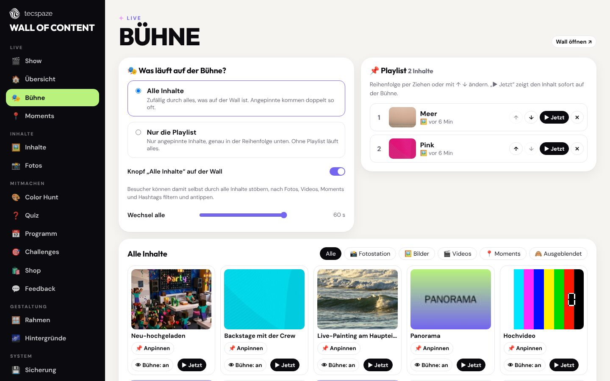

- **Was läuft auf der Bühne?**
  - **Alle Inhalte:** zufällig durch alles, was auf der Wall ist. Angepinnte Inhalte kommen doppelt so oft.
  - **Nur die Playlist:** nur angepinnte Inhalte, genau in der Reihenfolge der Playlist. Ist nichts angepinnt, läuft alles.
- **📌 Anpinnen** nimmt einen Inhalt in die Playlist auf. Die Reihenfolge änderst du per Ziehen oder mit **↑ ↓**.
- **👁 Bühne: an / 🙈 Bühne: aus** blendet einen Inhalt nur für die Bühne aus. Im Mosaik und unter „Alle Inhalte“ bleibt
  er sichtbar.
- **▶ Jetzt** zeigt einen Inhalt sofort auf der Bühne (im Mosaik in der großen Kachel).

**„Alle Inhalte“ für Besucher:** Oben auf der Wall (Bühne und Mosaik) sitzt der grüne Knopf **▦ Alle Inhalte**. Er öffnet ein
großes Raster mit allen Inhalten zum Stöbern – mit Filtern für Fotostation, Bilder, Videos, Moments und die Hashtags der
Moments. Antippen zeigt den Inhalt groß; danach ist man wieder im Raster. Nach 45 Sekunden ohne Berührung schließt sich das
Raster von selbst. Den Knopf kannst du unter „Bühne“ ausschalten.

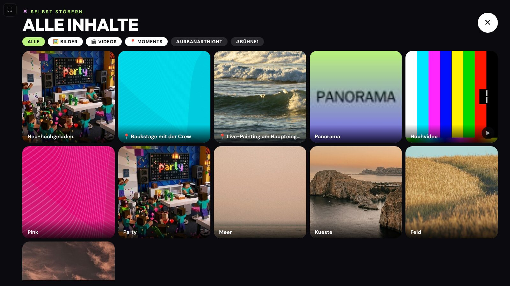

---

## 19. Live-Modus: Moments der Redaktion

Die Redaktion fotografiert oder filmt während der Veranstaltung mit dem eigenen Handy und schickt **Moments** direkt auf
die Wall – mit Bildunterschrift und Hashtags.

**Einrichten:**

1. Als David R. unter **Benutzer** einen Benutzer mit der Rolle **„Redaktion – nur Live-Kamera“** anlegen und ein Passwort
   festlegen. (Auch Admins können die Live-Kamera benutzen.)
2. Unter **Live → 📍 Moments** steht die Adresse der Live-Kamera (`http://<laptop-ip>:3000/live`) mit QR-Code. Die Handys
   müssen im selben WLAN sein.

**Auf dem Handy:** Profilbild antippen, Passwort eingeben. Dann **Foto aufnehmen**, **Video** oder **Galerie** wählen,
optional eine Bildunterschrift schreiben, Hashtags antippen (Vorschläge aus dem Admin-Panel) oder eigene eintippen,
**Posten**. Unten stehen die eigenen Moments mit Status („Auf der Wall“, „Wartet auf Freigabe“) und lassen sich löschen.
Fotos werden vor dem Hochladen auf eine sinnvolle Größe verkleinert, damit es auch im vollen WLAN schnell geht.

| Live-Kamera | Moment bearbeiten |
|---|---|
| 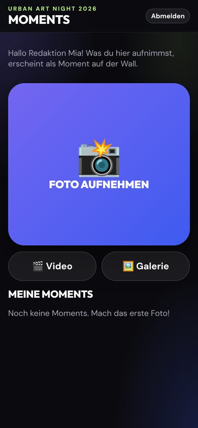 | 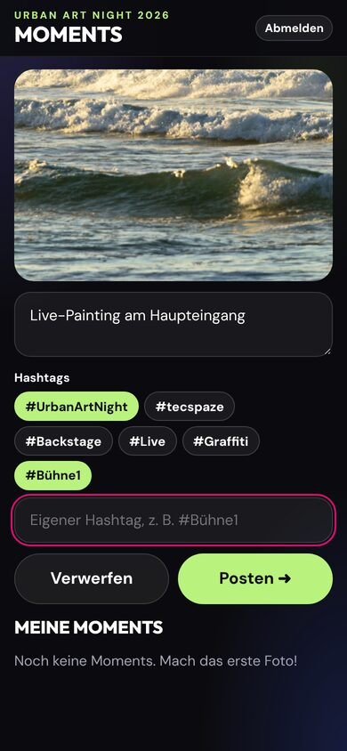 |

**So erscheinen Moments** (unter Moments einstellbar, alles kombinierbar):

| Option | Wirkung |
|---|---|
| Sofort groß auf die Bühne | Ein neuer Moment springt sofort auf die Bühne (im Mosaik in die große Kachel). Aus: er läuft ganz normal mit. |
| Erst nach Freigabe zeigen | Moments warten im Admin-Panel (Badge an „Moments“), bis jemand **✔ Freigeben** klickt. |
| Live-Ticker im Band | Die neuesten Moments wechseln sich im Band unten ab. |
| „LIVE“ für … Minuten | So lange trägt ein Moment das pinke **● Live Moment**-Abzeichen, danach „📍 Moment“. |
| Hashtag-Vorschläge | Diese Hashtags kann die Redaktion mit einem Tipp auswählen. |

Auf der Bühne zeigt ein Moment das Abzeichen, die Bildunterschrift, die Hashtags und wer ihn gepostet hat.

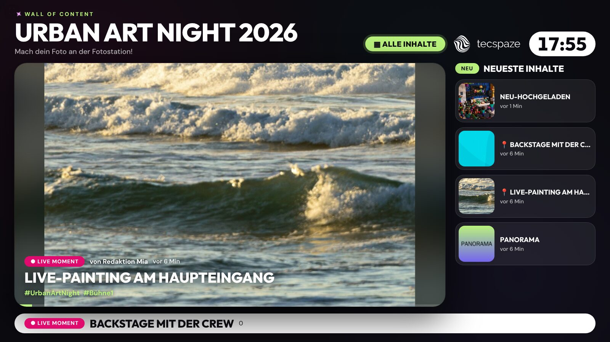

In der Liste **Alle Moments** kannst du Text und Hashtags nachträglich ändern, Moments freigeben, von der Wall nehmen,
sofort auf die Bühne holen oder löschen.

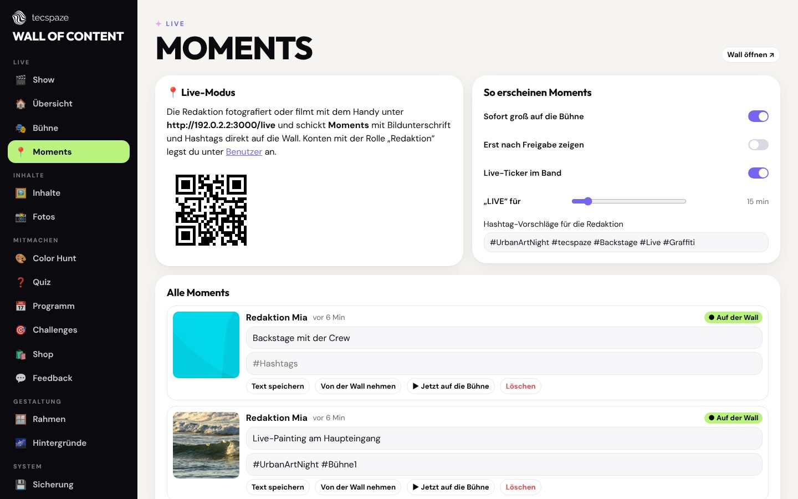

---

## 20. Daten, Updates und Sicherung

**Wo liegen die Daten?** Alles, was ihr hochladet und einstellt – Inhalte, Fotos, Benutzer mit Passwörtern, Einstellungen,
Programm, Shop, eigene Rahmen, Hintergründe und Profilbilder – liegt im Ordner **„Wall of Content Daten“** in deinem
Benutzerordner (auf dem Mac also `/Users/<name>/Wall of Content Daten`), nicht mehr im Programmordner. Das Terminal zeigt den
Pfad beim Start unter „Daten:“ an.

**Neue Version herunterladen:** Einfach die neue Version entpacken und starten – sie findet den Datenordner automatisch.
Du musst nichts kopieren und dich nicht neu anmelden.

**Umstieg von einer älteren Version:** Beim ersten Start sucht die App nach alten Daten und übernimmt den neuesten Stand
automatisch: zuerst `data/` im eigenen Programmordner, dann ältere Wall-of-Content-Ordner daneben, in Downloads,
Schreibtisch und Dokumente. Kopiert werden Uploads, Fotos, Benutzer, Passwörter, Einstellungen und eigene Dateien aus dem
alten `assets/`-Ordner. Das Original bleibt unverändert; dort liegt danach eine Datei `UMGEZOGEN.txt`. Das Terminal meldet
„✔ Alte Daten übernommen aus …“.

**Admin-Panel → System → 💾 Sicherung** (nur Global Admin):

- **Sicherung herunterladen:** eine ZIP-Datei mit allen Daten – z. B. als Notfall-Kopie oder für einen anderen Laptop.
- **Sicherung einspielen:** ZIP-Datei aus „Sicherung herunterladen“ oder „Paket teilen“ wählen. Die App prüft sie, legt den
  aktuellen Stand beiseite (im Datenordner unter `.vorher-<Datum>`, die zwei neuesten bleiben) und startet sich von selbst
  neu. Das Admin-Panel lädt danach automatisch neu.
- **Aus altem Ordner übernehmen:** Pfad zu einer älteren Version eintragen (oder **🔍 Auf diesem Rechner suchen** und
  **Übernehmen** antippen). Auch das startet die App von selbst neu.

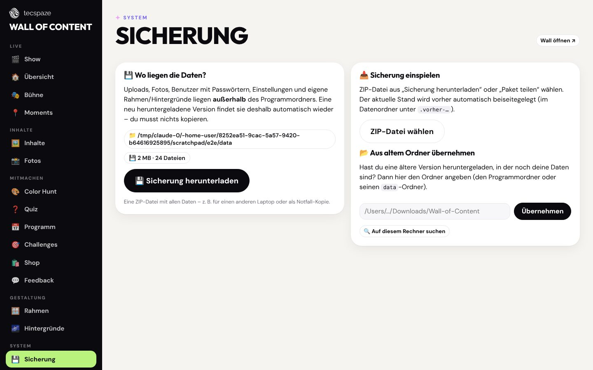

Einen anderen Datenordner kannst du mit `DATA_DIR=/pfad npm start` festlegen.

---

## 21. Läuft gerade: Songtitel mit Schallplatte

Auf der Wall erscheint – wie die QR-Codes – eine **drehende Schallplatte** mit dem Cover in der Mitte, dem **Songtitel** und
dem **Interpreten**. Bei jedem neuen Song wird die Platte neu „aufgelegt“; ist die Musik pausiert, verschwindet sie.

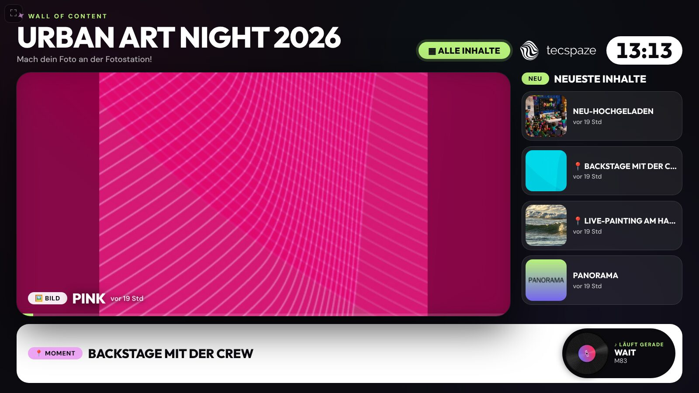

Einschalten im **Show-Modus → 🎵 Läuft gerade**. Dort siehst du auch, welcher Song erkannt wurde und woher.

| Quelle | So funktioniert es |
|---|---|
| **Dieser Rechner** (Apps **und Browser**) | Musik auf dem Laptop, auf dem die Wall of Content läuft, wird automatisch erkannt – auch **Spotify Web, YouTube Music, SoundCloud** im Browser. **Linux:** über die Medien-Schnittstelle des Desktops (MPRIS) – Chrome, Chromium, Brave, Edge, Firefox, Spotify, VLC … mit Titel, Interpret und Cover. Wichtig: den Server im Terminal des angemeldeten Desktops starten. **Mac:** Spotify- und Musik-App mit Cover sowie Browser-Tabs von Chrome, Brave, Edge, Arc, Vivaldi und Safari (Titel aus dem Tab). Beim ersten Mal fragt macOS, ob das Terminal die App bzw. den Browser steuern darf: **OK** klicken (sonst: Systemeinstellungen → Datenschutz & Sicherheit → Automation). Wer `nowplaying-cli` (Homebrew) installiert hat, bekommt alles, was macOS unter „Jetzt läuft“ zeigt. **Windows:** alle Apps und Browser, die im Lautstärke-Fenster von Windows erscheinen. |
| **DJ-Software** | Die App liest den letzten Eintrag einer Textdatei („Interpret - Titel“). **VirtualDJ** schreibt sie selbst (`Dokumente/VirtualDJ/History/tracklist.txt`, wird automatisch gefunden). Für **Serato, Traktor oder Rekordbox** ein Zusatzprogramm wie „What's Now Playing“ eine Textdatei schreiben lassen und deren Pfad im Show-Modus eintragen. |

| **Von Hand** | Quelle „Von Hand eintragen“ wählen und „Interpret - Titel“ eintippen, z. B. für eine Live-Band. |

Mit **Quelle → Automatisch** gewinnt dieser Rechner, solange dort etwas spielt (Musik-Apps vor dem Browser); sonst kommt der
Song aus der DJ-Datei. Unter dem Schalter zeigt das Admin-Panel, welche Player gefunden wurden („Dieser Rechner: Chrome (spielt:
…)“) – und falls etwas fehlt, einen Hinweis, was zu tun ist.

**Musik läuft auf einem anderen Gerät** (Handy, DJ-Laptop, Bluetooth-Box)? Dann sieht die Wall of Content sie nicht – dafür
„DJ-Software“ oder „Von Hand“ nutzen.
Einträge, die älter als 45 Minuten sind, gelten nicht mehr als „läuft gerade“.

---

## 22. Livestream aus OBS auf der Wall

Mit OBS kannst du ein Livebild – z. B. die Kamera an der Bühne – direkt auf die Wall schicken. Die Wall of Content hat dafür
einen eigenen Stream-Empfänger; du brauchst keinen YouTube- oder Twitch-Account.

**In OBS einrichten** (die Werte stehen im Admin-Panel unter **Live → 📡 Livestream** zum Kopieren):

1. OBS → **Einstellungen → Stream**, Dienst **„Benutzerdefiniert…“**.
2. **Server:** `rtmp://<laptop-ip>:1935/live` (läuft OBS auf demselben Laptop, geht auch `rtmp://localhost:1935/live`).
3. **Stream-Key:** den Key aus dem Admin-Panel einfügen.
4. **Stream starten** – nach ein, zwei Sekunden läuft das Bild auf der Wall; im Admin-Panel steht „● LIVE“ mit Vorschau.

Empfohlen unter **Einstellungen → Ausgabe**: H.264 (x264 oder Hardware-Encoder), Keyframe-Intervall 2 s, 2500–6000 kbit/s.
Läuft OBS auf einem anderen Rechner, muss er im selben Netz sein. Fragt macOS beim ersten Start, ob „node“ eingehende
Verbindungen annehmen darf: **Erlauben**.

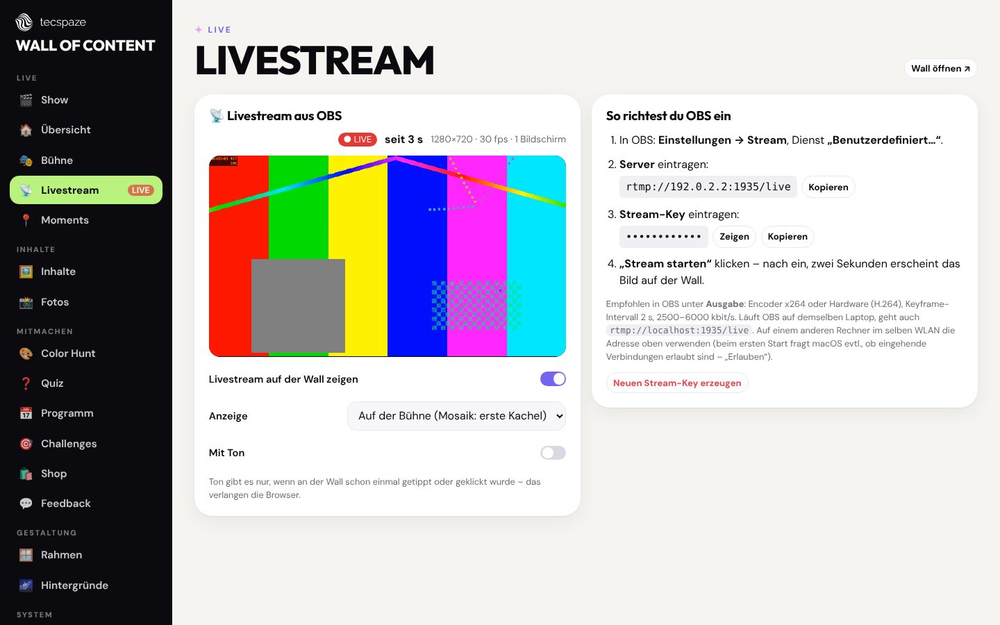

**Anzeige auf der Wall** (im Admin-Panel unter Livestream):

| Einstellung | Wirkung |
|---|---|
| Groß über der ganzen Wall | Das Livebild füllt den Bildschirm; QR-Codes und „Läuft gerade“ bleiben sichtbar. |
| Auf der Bühne | Das Livebild läuft in der Bühne (im Mosaik in der ersten Kachel), der Rest der Wall bleibt. Im klassischen Design: groß. |
| Bild-im-Bild | Kleines Fenster oben rechts. |
| Mit Ton | Ton nur, wenn an der Wall schon einmal getippt wurde – das verlangen die Browser. |

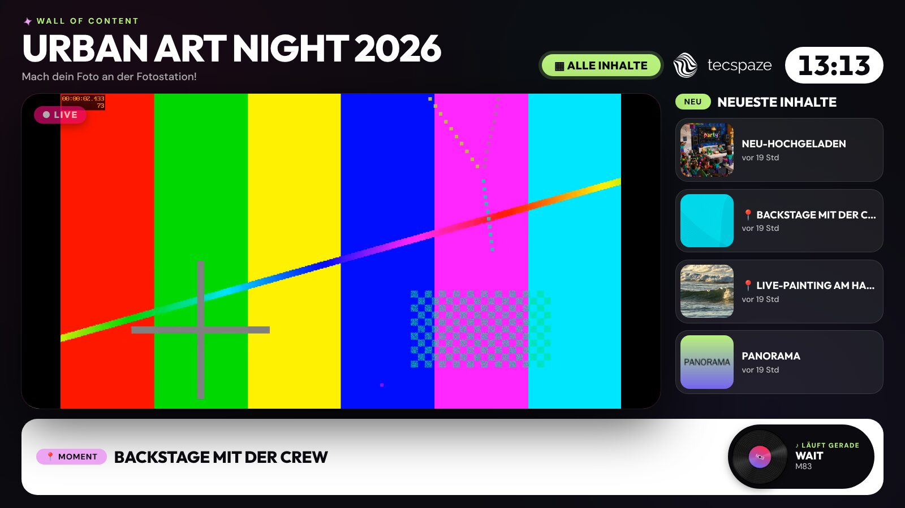

Sobald OBS den Stream beendet, zeigt die Wall wieder ihre Inhalte; das DVD-Logo startet nicht, solange der Stream läuft.
Es kann immer nur ein Stream gleichzeitig senden. **„Neuen Stream-Key erzeugen“** macht den alten Key sofort ungültig (z. B.
wenn er in falsche Hände geraten ist). Anderer Port: `RTMP_PORT=1936 npm start`, ausschalten mit `RTMP_PORT=0`.
