# Wall of Content – Anleitung

Diese Anleitung erklärt, wie du die Wall of Content startest, einrichtest und während der Veranstaltung bedienst.

**Inhalt**

1. [Was gehört dazu?](#1-was-gehört-dazu)
2. [Installieren und starten](#2-installieren-und-starten)
3. [Anmelden im Admin-Panel und Benutzer](#3-anmelden-im-admin-panel-und-benutzer)
4. [Die Wall](#4-die-wall)
5. [Inhalte, Hintergründe und Rahmen](#5-inhalte-hintergründe-und-rahmen)
6. [Fotostation](#6-fotostation)
7. [Color Hunt](#7-color-hunt)
8. [Quiz auf dem iPad](#8-quiz-auf-dem-ipad)
9. [Besucher-App: Programm, Challenges, Merch-Shop, Feedback](#9-besucher-app-programm-challenges-merch-shop-feedback)
10. [Verbund-Wall aus mehreren iPads (experimentell)](#10-verbund-wall-aus-mehreren-ipads-experimentell)
11. [Einstellungen](#11-einstellungen)
12. [Checkliste für den Veranstaltungstag](#12-checkliste-für-den-veranstaltungstag)
13. [Probleme und Lösungen](#13-probleme-und-lösungen)

---

## 1. Was gehört dazu?

Ein Laptop ist der **Server**. Alle anderen Geräte öffnen nur eine Adresse im Browser – Apps müssen nicht installiert werden.

| Gerät | Adresse | Wofür |
|---|---|---|
| Großer Bildschirm / Beamer | `http://<laptop-ip>:3000/` | Die **Wall** mit schwebenden Bildern und Videos |
| Handy oder Tablet an der Fotostation | `https://<laptop-ip>:3443/station` | **Fotostation**: Rahmen wählen, Foto machen, QR-Code |
| iPad für Kinder | `http://<laptop-ip>:3000/quiz` | **Quiz** – zeigt die Wall, solange kein Quiz läuft |
| Handys der Gäste | `http://<laptop-ip>:3000/app` | **Besucher-App**: Live-Programm, Challenges, Merch-Shop, Feedback |
| Handys der Gäste | `http://<laptop-ip>:3000/hunt` | **Color Hunt** (Gäste scannen den QR-Code auf der Wall) |
| Mehrere iPads nebeneinander | `http://<laptop-ip>:3000/?pos=1`, `?pos=2`, … | **Verbund-Wall** (experimentell) |
| Dein Laptop/Handy | `http://<laptop-ip>:3000/admin` | **Admin-Panel** zum Steuern |

`<laptop-ip>` ist die Adresse des Laptops im WLAN, z. B. `192.168.1.10`. Sie steht nach dem Start im Terminal, und im
Admin-Panel unter **Übersicht** gibt es zu jeder Adresse einen QR-Code.

> **Wichtig:** Alle Geräte müssen im **selben WLAN** sein wie der Laptop.

---

## 2. Installieren und starten

> **Mac?** Am einfachsten geht es mit dem Startskript zum Doppelklicken – ohne etwas zu installieren.
> Alles dazu steht in der [Mac-Anleitung](MAC.md).

Für den Start über das Terminal (Windows, Linux oder Mac) wird einmalig [Node.js](https://nodejs.org) (Version 18 oder neuer) gebraucht.

**Code holen** – entweder als ZIP herunterladen und entpacken
([Download](https://github.com/theD-Creator/Wall-of-Content/archive/refs/heads/claude/wall-of-content-photo-stations-blixdl.zip))
oder mit Git:

```bash
git clone https://github.com/theD-Creator/Wall-of-Content.git
```

```bash
cd Wall-of-Content
```

```bash
git checkout claude/wall-of-content-photo-stations-blixdl
```

**Abhängigkeiten installieren** (nur beim ersten Mal und nach Updates):

```bash
npm install
```

**Starten:**

```bash
npm start
```

Im Terminal erscheint dann zum Beispiel:

```
  Wall of Content läuft

  Wall (Bildschirm):   http://localhost:3000/        (im Netzwerk: http://192.168.1.10:3000/)
  Fotostation (Handy): https://192.168.1.10:3443/station
  Admin-Panel:         http://localhost:3000/admin   (im Netzwerk: http://192.168.1.10:3000/admin)
  Color Hunt (Gäste):  http://192.168.1.10:3000/hunt
  Quiz (iPad):         http://192.168.1.10:3000/quiz

  Anmeldung im Admin-Panel als David R. (Global Admin)
  Passwort:            Ab3xY7kQ9zLm   (Startpasswort, steht auch in data/admin-password.txt)
```

Beenden mit `Strg + C`. Alle Fotos, Einstellungen und Ranglisten bleiben im Ordner `data/` erhalten.

**Updates einspielen:**

```bash
git pull
```

```bash
npm install
```

Danach wieder `npm start`.

---

## 3. Anmelden im Admin-Panel und Benutzer

Öffne `http://localhost:3000/admin`, tippe auf dein Profilbild und gib dein Passwort ein.

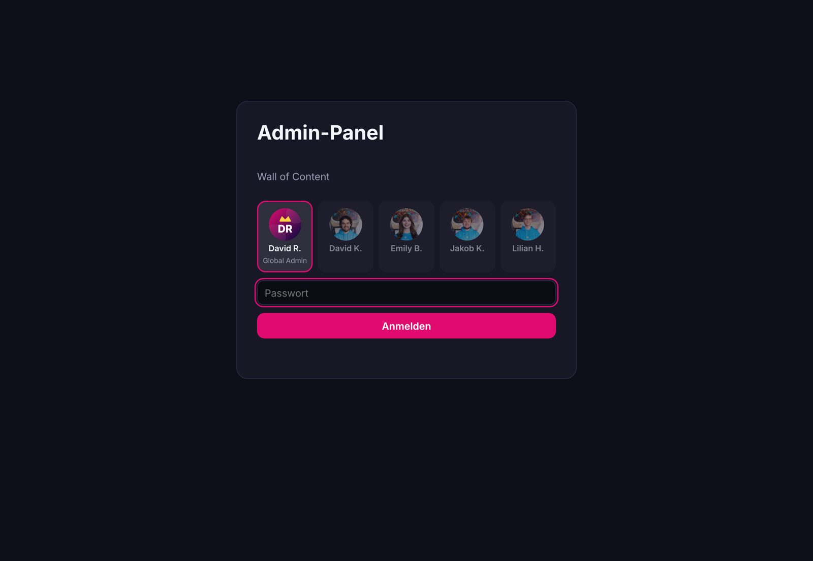

Es gibt fünf Benutzer:

| Benutzer | Rolle |
|---|---|
| **David R.** | Global Admin – darf zusätzlich Benutzer verwalten und Passwörter vergeben |
| David K., Emily B., Jakob K., Lilian H. | Admin – dürfen alles außer die Benutzerverwaltung |

**Erste Anmeldung:** Nur David R. hat am Anfang ein Passwort – das **Startpasswort** aus dem Terminal bzw. aus
`data/admin-password.txt`. Die anderen Benutzer sind ausgegraut, bis David R. ihnen ein Passwort gibt:

1. Als David R. anmelden und den Tab **Benutzer** öffnen.
2. Beim jeweiligen Benutzer ein Passwort (mind. 6 Zeichen) eintragen und auf **Festlegen** klicken.
3. Das Passwort der Person mitteilen. Sie kann es später unter **Einstellungen → Mein Passwort ändern** selbst ändern.

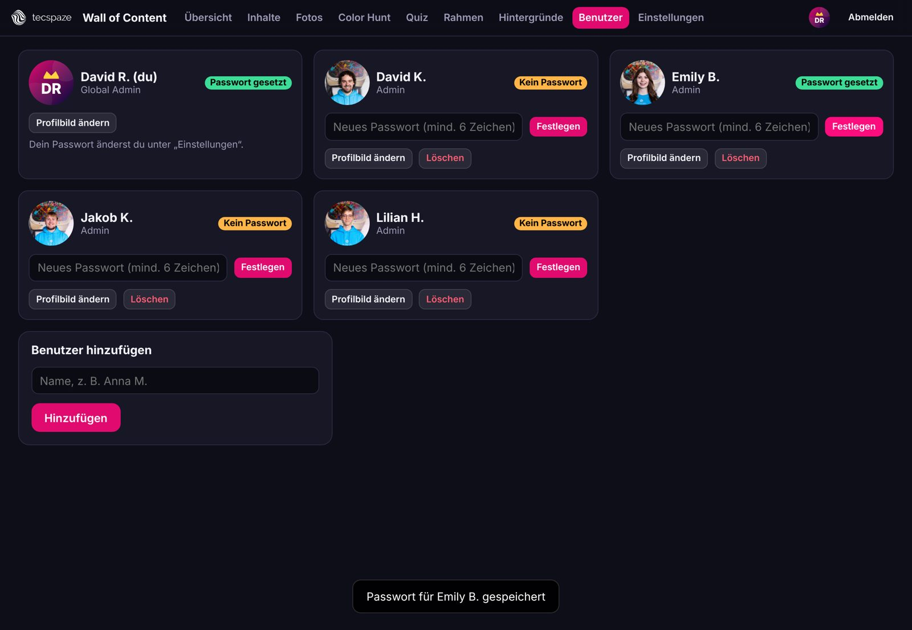

Im Tab **Benutzer** kann David R. außerdem Profilbilder ändern, neue Benutzer hinzufügen und Benutzer löschen.
Sobald David R. sein eigenes Passwort ändert, wird `data/admin-password.txt` gelöscht – das Startpasswort gilt dann nicht mehr.

**Passwort vergessen?** Den Server einmal so starten – dann gilt dieses Passwort für den Global Admin:

```bash
ADMIN_PASSWORD=neuesPasswort npm start
```

---

## 4. Die Wall

Die Wall läuft im Browser auf dem großen Bildschirm. Mit der Taste **F** (oder Doppelklick auf den Hintergrund)
geht sie in den Vollbildmodus.


- Bilder und Videos schweben als Kacheln herum. Berühren sich zwei Kacheln, prallen sie voneinander ab und leuchten kurz auf.
- **Nur wer auf eine Kachel tippt oder klickt**, öffnet das Bild bzw. Video. Von selbst öffnet sich nichts.
  Mit **„Jetzt zeigen“** im Admin-Panel kannst du einen Inhalt gezielt öffnen.
- Neue Fotos von der Fotostation erscheinen sofort mit einer „NEU“-Animation.


Läuft gerade ein Color Hunt, erscheint unten links ein QR-Code; ist die Quiz-Rangliste eingeschaltet, steht sie oben rechts:

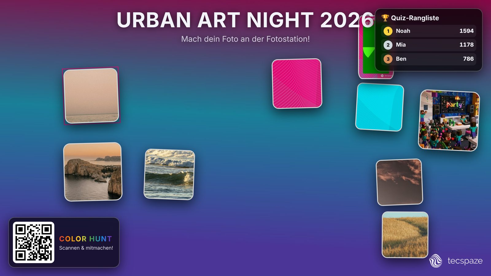

---

## 5. Inhalte, Hintergründe und Rahmen

### Bilder und Videos für die Wall

Im Tab **Inhalte** Dateien hineinziehen oder auswählen (JPG, PNG, WebP, GIF, MP4, WebM, MOV). Jede Kachel lässt sich
ein-/ausblenden, betiteln, sofort zeigen oder löschen. Alternativ Dateien direkt in den Ordner `assets/media/` legen –
sie erscheinen automatisch.


### Hintergrund – auch als animiertes Video

Im Tab **Hintergründe** ein Bild **oder ein Video** (MP4 oder WebM) hochladen und auf **Verwenden** klicken.
Videos laufen stumm in Endlosschleife hinter der Wall, der Fotostation und dem Quiz. Ein kurzes, ruhiges Video
(10–30 Sekunden, Full HD) funktioniert am besten.


### Rahmen für die Fotostation

Im Tab **Rahmen** sind eure Event-Hintergründe hinterlegt. Das Foto wird in das abgerundete Fenster in der Mitte gesetzt.
Rahmen lassen sich ein-/ausschalten, umbenennen und neu hochladen (am besten 1080 × 1920 px, Vorlage:
`docs/foto-layout.png`). Bilder mit Transparenz (PNG) werden stattdessen über das Foto gelegt.

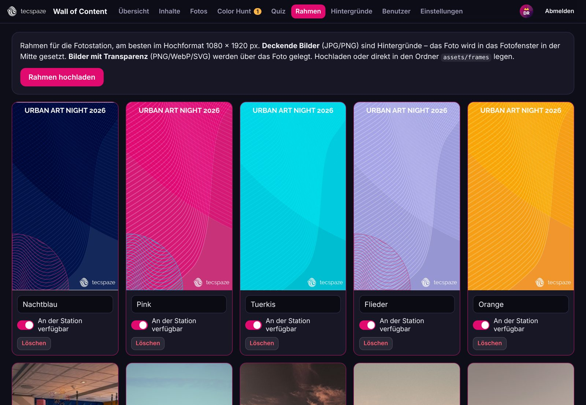

---

## 6. Fotostation

Das Handy oder Tablet an der Fotostation öffnet `https://<laptop-ip>:3443/station`.

> Beim ersten Öffnen erscheint eine **Zertifikatswarnung**. Einmal bestätigen („Erweitert“ → „Trotzdem fortfahren“) –
> sonst gibt der Browser die Kamera nicht frei. Mit `?name=Eingang` am Ende der Adresse bekommt die Station einen Namen.

| 1. Start | 2. Rahmen wählen | 3. Kontrolle | 4. QR-Code |
|---|---|---|---|
| 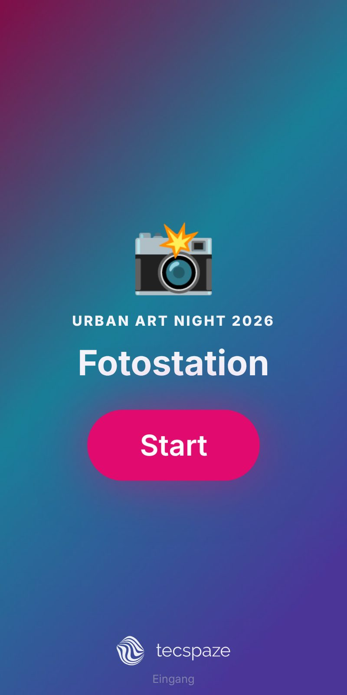 | 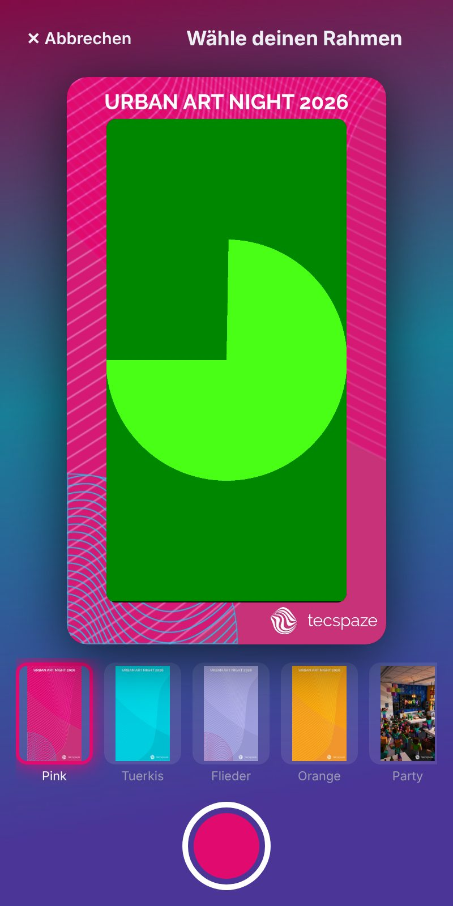 |  | 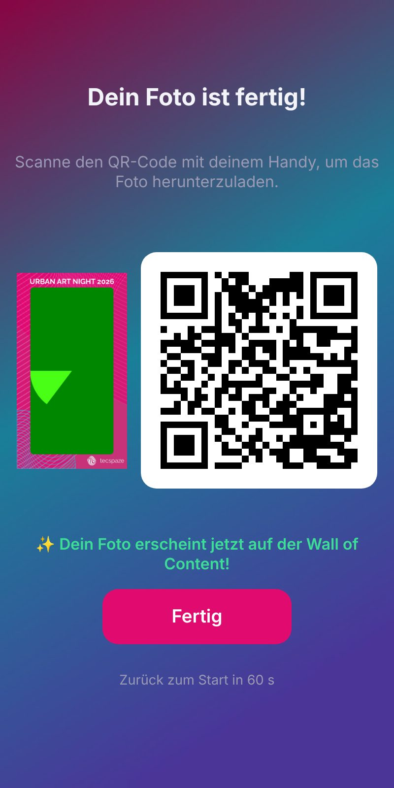 |

1. **Start** antippen.
2. Rahmen auswählen, Auslöser drücken – nach dem Countdown wird das Foto gemacht.
3. Foto prüfen. Der Haken **„Mein Foto auf der Wall of Content anzeigen“** entscheidet, ob es auf der Wall erscheint.
4. Mit dem QR-Code lädt der Gast das Foto auf sein eigenes Handy herunter.

Alle Fotos findest du im Tab **Fotos**. Fotos ohne Haken können nicht auf die Wall gelegt werden.
Mit „Moderation“ (Einstellungen) erscheinen Fotos erst nach deiner Freigabe.

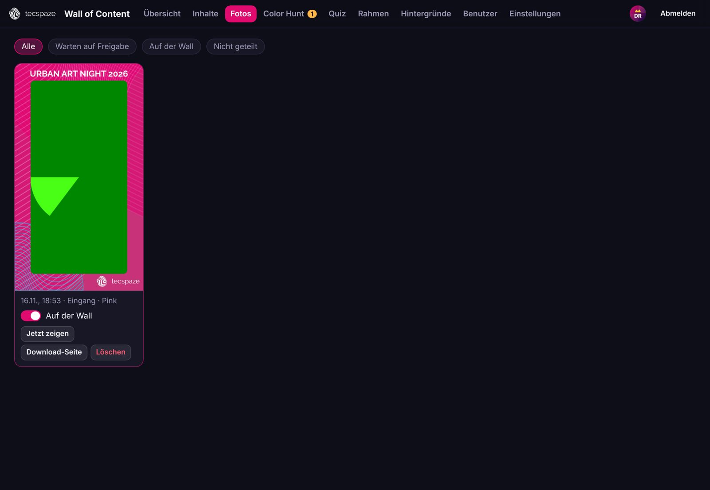

---

## 7. Color Hunt

Gäste suchen mit dem eigenen Handy Dinge in einer bestimmten Farbe.

1. Im Tab **Color Hunt** den Schalter **„Geöffnet“** einschalten – auf der Wall erscheint ein QR-Code.
2. Gäste scannen ihn, geben ihren **Namen** ein und bekommen eine **Farbe**.
3. Nach der **Anleitung** startet mit „Start“ die Zeit: **5 Minuten** für **5 Fotos** in ihrer Farbe.
4. Danach tippen sie auf **Abgeben** – spätestens wenn die Zeit abläuft, wird automatisch abgegeben.
5. Jede Person kann **nur einmal** mitmachen (pro Handy und pro Name).

| Name | Farbe | Anleitung | Fotos |
|---|---|---|---|
|  |  |  |  |

### Countdown für die ganze Challenge

Im Tab **Color Hunt** kannst du festlegen, wie lange die Challenge insgesamt noch läuft:

1. Minuten eintragen (z. B. `30`) und auf **Countdown starten** klicken – der Color Hunt öffnet sich dabei automatisch.
2. Mit **+5 Min** / **−5 Min** verlängerst oder verkürzt du jederzeit, **Countdown stoppen** entfernt ihn (die Challenge bleibt offen).
3. Die Restzeit läuft auf der **Wall** im QR-Kasten mit, die **letzten 10 Sekunden** erscheinen groß in der Mitte, danach „Zeit ist um!“.
4. Auch auf den **Handys der Gäste** steht „Die Challenge endet in …“. Wer kurz vor Schluss startet, hat nur noch die Restzeit
   statt der vollen 5 Minuten.
5. Ist der Countdown abgelaufen, **schließt der Color Hunt automatisch**: keine neuen Anmeldungen mehr, und alle, die gerade
   noch fotografieren, geben automatisch ab. Danach kannst du in Ruhe den Sieger wählen.

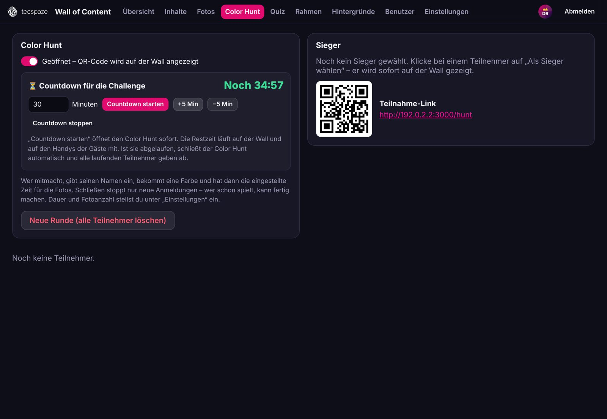

| Wall mit Countdown | Die letzten Sekunden | Handy des Gastes |
|---|---|---|
|  | 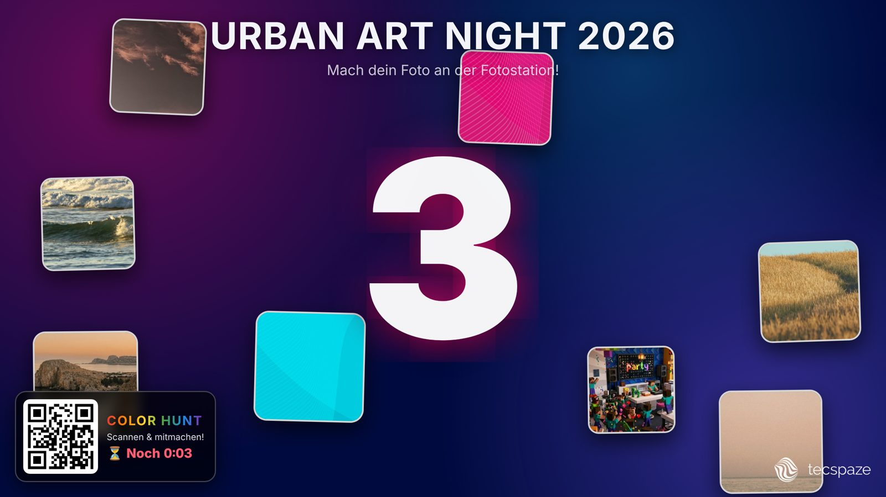 | 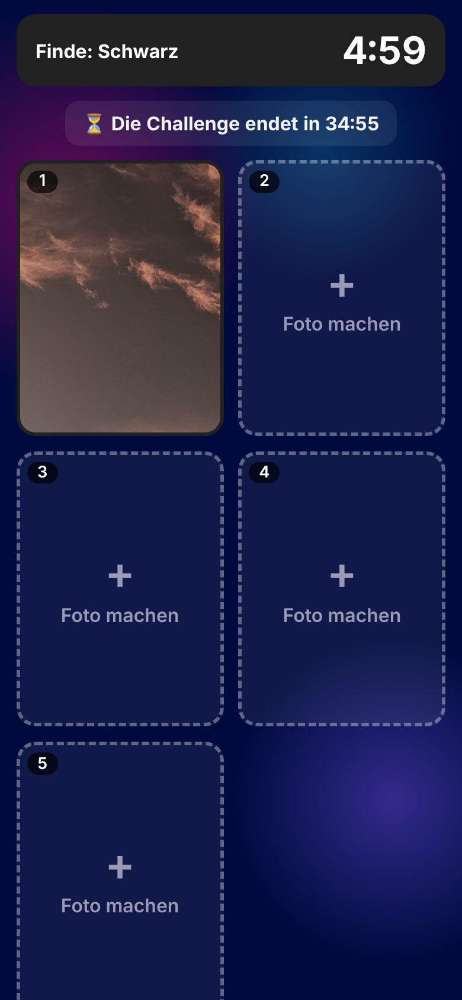 |

### Teilnehmer und Sieger

Im Admin-Panel siehst du alle Teilnehmer live – mit Farbe, Restzeit und Fotos. Mit **„Als Sieger wählen“** erscheint der
Sieger sofort groß auf der Wall, bis du ihn mit **„Auf der Wall ausblenden“** wieder wegnimmst.
**„Neue Runde“** löscht alle Teilnehmer und Fotos.

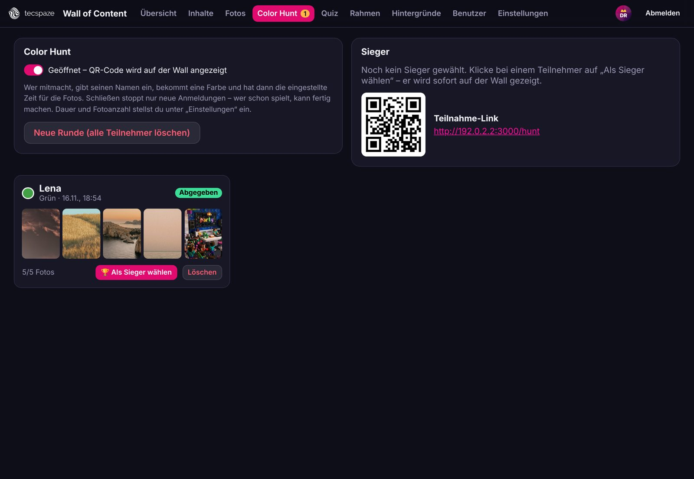

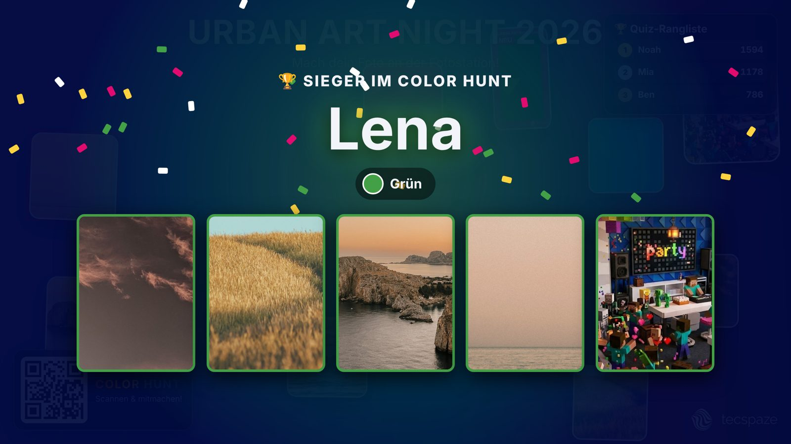

---

## 8. Quiz auf dem iPad

Ein Quiz für Kinder mit Rangliste. Das iPad öffnet `http://<laptop-ip>:3000/quiz`.

**Solange das Quiz nicht gestartet ist, zeigt das iPad einfach die Wall of Content.** Sobald du im Tab **Quiz** den Schalter
**„Quiz gestartet“** einschaltest, wechselt das iPad automatisch zum Quiz – und beim Ausschalten wieder zurück zur Wall.

| Startbildschirm | Name eingeben |
|---|---|
| 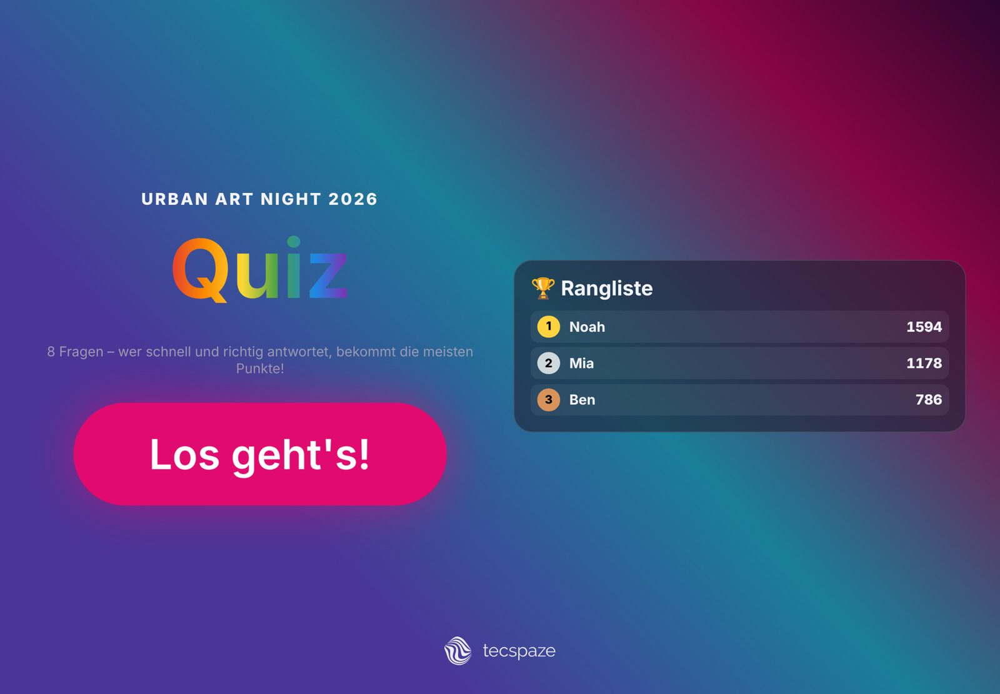 |  |

| Frage | Auflösung |
|---|---|
| 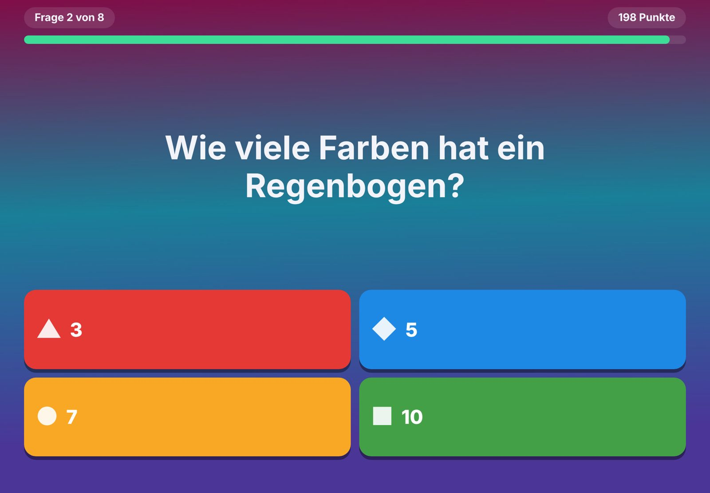 |  |

- Jede Runde hat **8 zufällige Fragen** mit je **20 Sekunden** (einstellbar unter Einstellungen → Quiz).
- Richtige Antworten geben **100 Punkte plus bis zu 100 Bonuspunkte**, je schneller, desto mehr.
- Am Ende sieht das Kind seine Punkte, seinen Platz und die **Rangliste**. Nach 30 Sekunden geht es automatisch zurück zum Start.

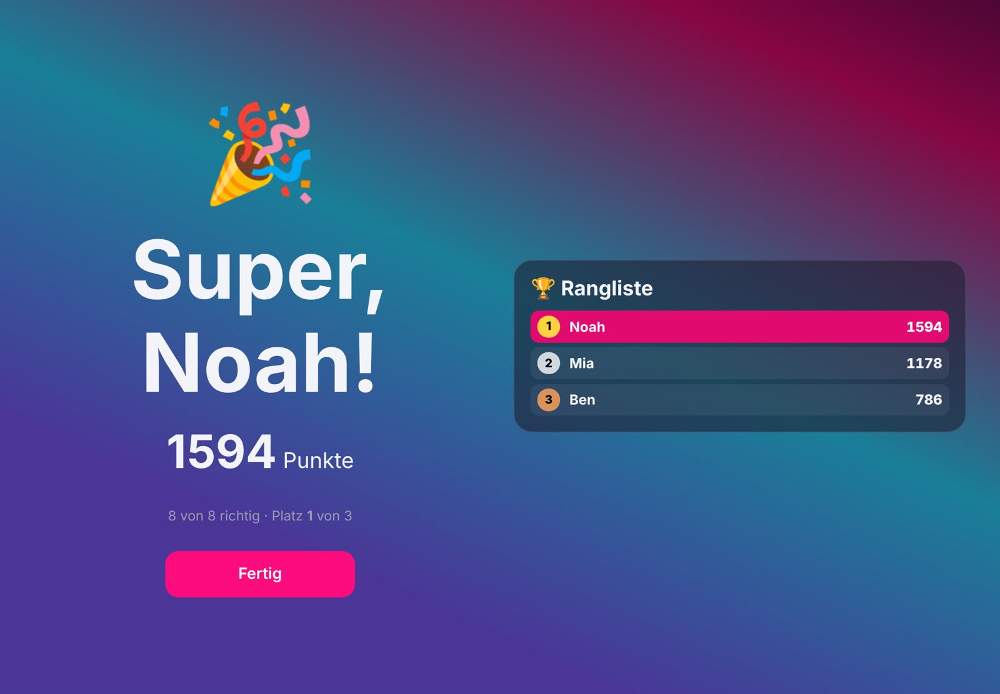

Im Tab **Quiz** kannst du:

- das Quiz starten und stoppen,
- die **Rangliste auf der Wall** einblenden,
- Fragen hinzufügen, bearbeiten und löschen (2–4 Antworten, die richtige mit dem Punkt markieren),
- einzelne Einträge oder die ganze Rangliste löschen.

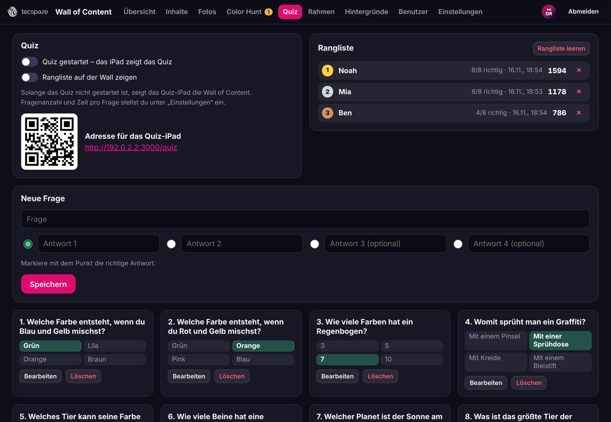

**Tipps für das iPad:**

- Adresse in Safari öffnen, dann **Teilen → „Zum Home-Bildschirm“** – so läuft das Quiz ohne Adressleiste im Vollbild.
- Unter **Einstellungen → Bedienungshilfen → Geführter Zugriff** das iPad auf diese App sperren, damit Kinder sie nicht verlassen.
- Automatische Sperre ausschalten (Einstellungen → Anzeige & Helligkeit → Automatische Sperre → Nie) und das iPad am Strom lassen.

---

## 9. Besucher-App: Programm, Challenges, Merch-Shop, Feedback

Die **Besucher-App** läuft auf den Handys der Gäste unter `http://<laptop-ip>:3000/app` – ohne Installation und ohne
Anmeldung. Unten gibt es vier Bereiche: **Programm**, **Challenges**, **Shop** und **Feedback**; oben steht immer der
Punktestand.

- Den QR-Code zur App findest du im Admin-Panel im Tab **Programm**. Mit dem Schalter **„QR-Code zur Besucher-App auf der
  Wall zeigen“** erscheint er unten links auf der Wall (über dem Color-Hunt-Code, falls der gerade läuft).
- Jeder Gast bekommt beim ersten Öffnen automatisch ein **anonymes Profil** auf seinem Handy. Daran hängen Punkte, Stempel,
  Coupons und Feedback – Namen werden nicht gespeichert.
- Unter **Challenges → „Dein Besucher-Code“** steht ein Code wie `U7QS-AWF3`. Damit nimmt man seinen Fortschritt auf ein
  anderes Handy oder in einen anderen Browser mit (z. B. wenn der Akku leer ist).
- Alles, was ihr im Admin-Panel ändert, erscheint **sofort** auf allen Handys – niemand muss neu laden.


### Live-Programm

**Einrichten (Tab „Programm“):** Titel, kurze Beschreibung, Datum, Beginn und Ende eintragen, optional
**★ Als Highlight hervorheben**, speichern. Mit ▲ ▼ legst du die Reihenfolge fest, **„Nach Uhrzeit sortieren“** ordnet
alles automatisch. Programmpunkte lassen sich jederzeit bearbeiten und löschen.

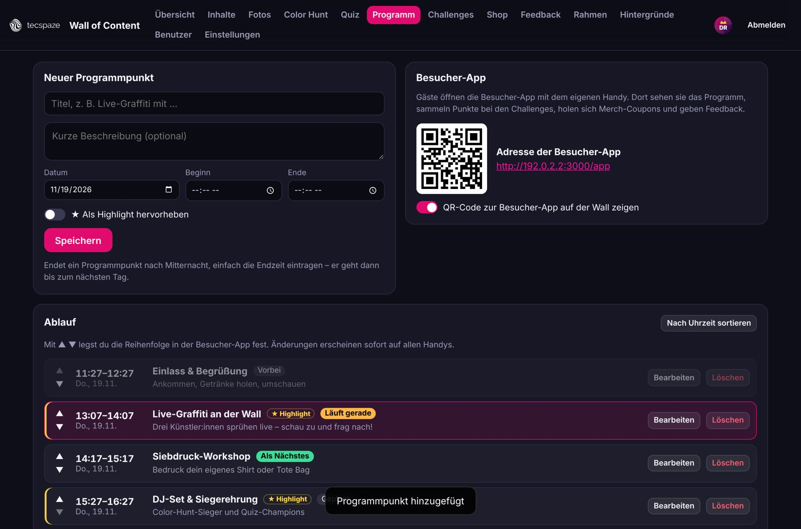

**Für die Gäste:** Oben steht groß, was **jetzt live** läuft (mit Restzeit) bzw. was **als Nächstes** kommt. In der
Liste ist der laufende Punkt pink markiert und mit Fortschrittsbalken versehen, der nächste trägt „Gleich“, vergangene
sind ausgegraut und durchgestrichen. Das aktualisiert sich automatisch anhand der Uhrzeit.

| Programm | Challenges | Stempel erhalten |
|---|---|---|
|  |  |  |

### Challenges – QR-Code-Challenge (Schatzsuche)

Es gibt bereits eine Challenge **„Finde den versteckten QR-Code auf dem Gelände!“**.

1. Im Tab **Challenges** auf **🖨️ Drucken** klicken (oder **⬇️ PNG** herunterladen), ausdrucken und auf dem Gelände verstecken.
2. Optional einen **Tipp** und die **Punkte** festlegen (Standard: 50). Weitere Challenges kannst du unten hinzufügen,
   mit dem Schalter **Aktiv** pausierst du eine.
3. Wer den Code findet, scannt ihn – mit der **Kamera-App** des Handys oder in der Besucher-App mit **„📷 QR-Code scannen“**.
   Die Challenge wird abgehakt und die Punkte gutgeschrieben.

**Sicherheit:** Jeder QR-Code enthält einen eigenen, nicht erratbaren Schlüssel. Ein beliebiger anderer QR-Code wird
abgelehnt („Unbekannter QR-Code“), und jede Challenge zählt pro Person nur **einmal**. Ist ein Foto des Codes im Umlauf,
macht **„Neuer Code“** den alten Ausdruck ungültig – danach neu ausdrucken.

### Challenges – Digitaler Rundgang mit Stempeln

1. Im Tab **Challenges** unter **Digitaler Rundgang** jede Station bzw. AG mit **Name** und **Beschreibung** anlegen.
2. **🖨️ Alle Stations-Codes drucken** – pro Station eine A4-Seite mit großem QR-Code. Alternativ einzeln drucken oder als PNG
   aufs Handy des Coaches laden.
3. An der Station zeigt der Coach den Code, der Gast scannt ihn → die Station bekommt einen **Stempel** und
   **10 Punkte** (einstellbar). Wer **alle** Stationen schafft, sieht eine Abschlussmeldung und bekommt **50 Bonuspunkte**
   (einstellbar).
4. Gäste sehen jederzeit ihren Fortschritt, z. B. „2 von 3 Stationen besucht“.

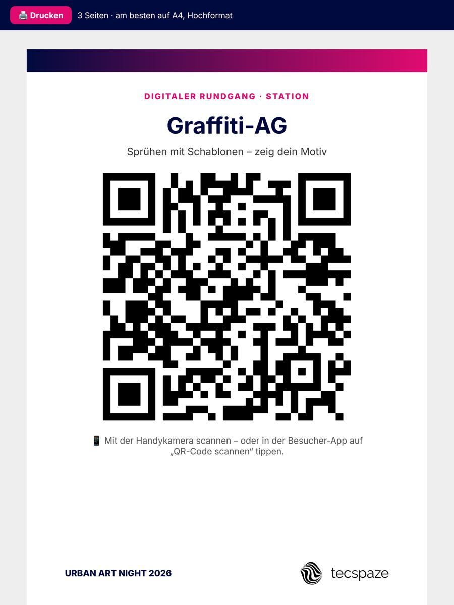

In der **Auswertung** siehst du, wie viele Besucher an jeder Station waren und wie viele den Rundgang komplett haben.

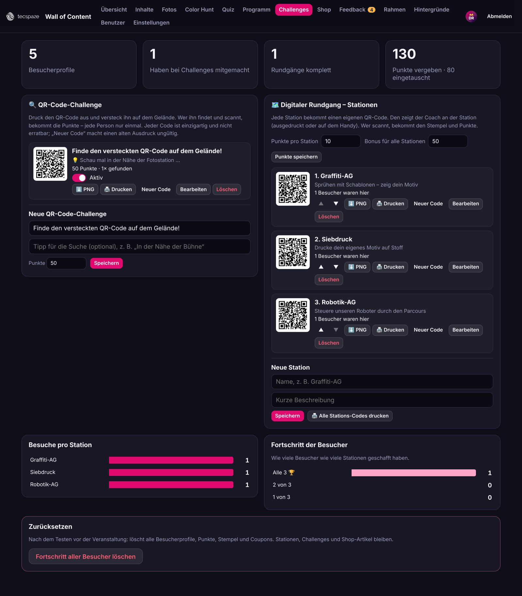

> **Scannen in der App:** Die Live-Kamera im Browser gibt es nur über HTTPS. Über die normale Adresse (`http://…:3000/app`)
> öffnet der Scanner stattdessen die Kamera für ein **Foto vom QR-Code** – das wird sofort ausgewertet. Am einfachsten
> ist ohnehin die **Kamera-App** des Handys: QR-Code scannen, Link antippen, fertig.

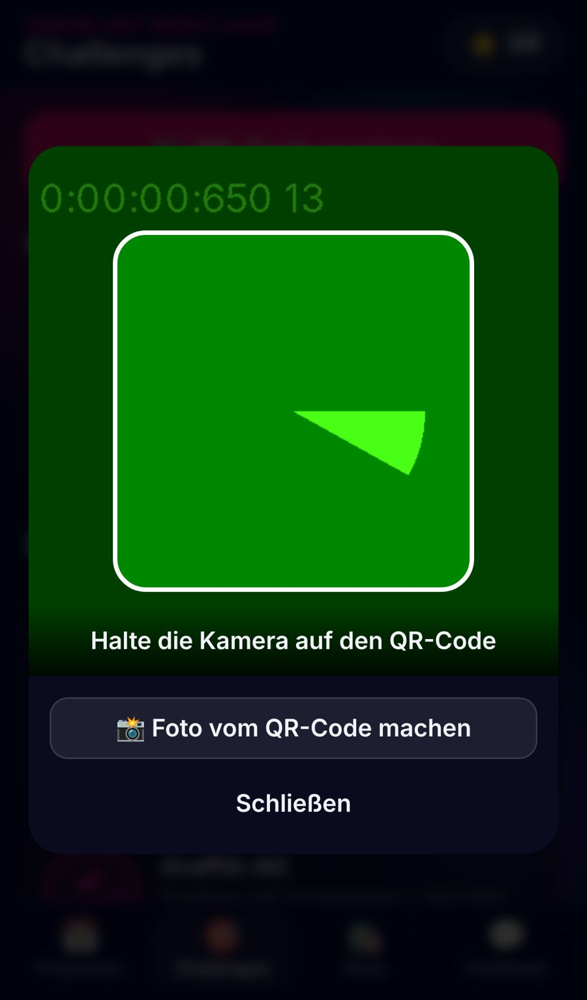

### Merch-Shop mit Coupons

**Einrichten (Tab „Shop“):** Artikel mit Name, Beschreibung, **Preis in Punkten**, optional **Bestand** (leer = unbegrenzt)
und Bild anlegen. Mit **„Im Shop sichtbar“** blendest du Artikel ein und aus.

**Für die Gäste:** Im Shop sehen sie ihre Punkte und alle Artikel. Reichen die Punkte, tippen sie auf **„Coupon holen“** –
die Punkte werden abgezogen und es erscheint ein **Coupon mit QR-Code und Code**. Alle Coupons stehen unter „Meine Coupons“.

| Shop | Coupon zum Vorzeigen | Nach dem Einlösen |
|---|---|---|
|  |  |  |

**Am Merch-Stand einlösen** – nur angemeldete Team-Mitglieder können einlösen:

- **Am schnellsten:** Den Coupon-QR-Code mit der **Kamera-App** eines Handys scannen, auf dem ihr im Admin-Panel angemeldet
  seid. Es öffnet sich die Einlöse-Seite → **„Jetzt einlösen“**.
- **Im Admin-Panel:** Tab **Shop → Coupon prüfen & einlösen**, Code eintippen oder **📷 Scannen**, dann **„Jetzt einlösen“**.

Danach ist der Coupon **gesperrt**: Auf dem Handy des Gastes steht sofort „EINGELÖST“, und ein zweiter Versuch zeigt
„Bereits eingelöst am … (Name)“. Ein noch nicht eingelöster Coupon kann **storniert** werden – die Punkte gehen zurück.

| Coupon prüfen im Admin-Panel | Einlöse-Seite: schon eingelöst |
|---|---|
| 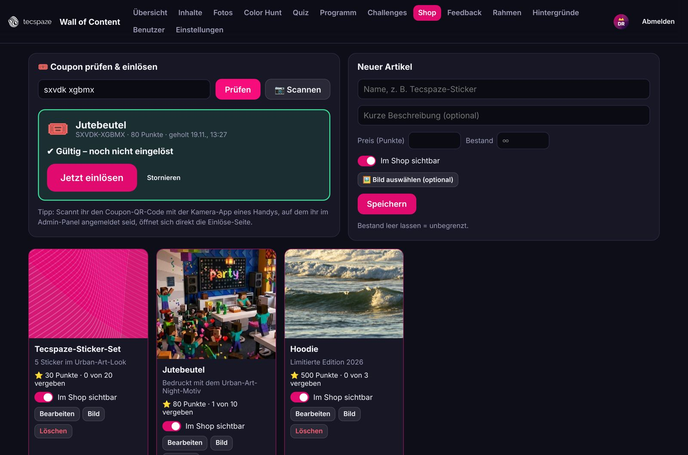 |  |

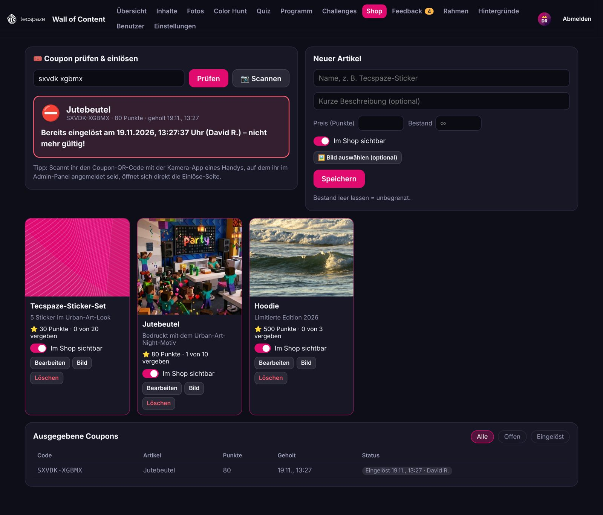

### Feedback

**Für die Gäste:** „Wie gefällt dir die Urban Art Night?“ – einen der fünf Smileys antippen, optional einen Text schreiben,
**„Feedback senden“**. Das Feedback ist **anonym**. Pro Handy gibt es **eine** Bewertung; wer nochmal sendet, ändert seine
bestehende Bewertung (so wird nichts doppelt gezählt).

| Feedback geben | Bestätigung |
|---|---|
| 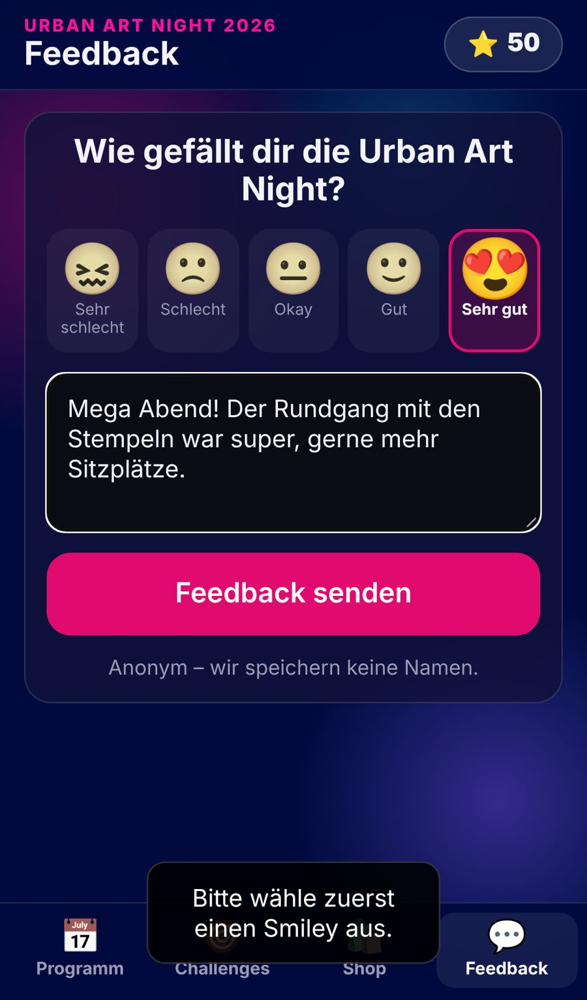 | 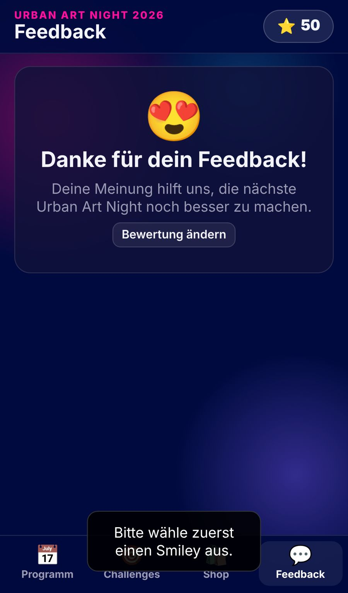 |

**Auswertung (Tab „Feedback“):** Durchschnittsbewertung, Verteilung der Smileys als Diagramm und alle Texte. Sortieren
nach Datum oder Bewertung, filtern nach Smiley, „Nur mit Text“ und „Nur ungelesene“, als gelesen markieren, löschen und
**als CSV für Excel** herunterladen.


### Vor der Veranstaltung: Testdaten löschen

Nach dem Ausprobieren im Tab **Challenges → Zurücksetzen → „Fortschritt aller Besucher löschen“** klicken (löscht Profile,
Punkte, Stempel und Coupons – Stationen, Challenges und Artikel bleiben). Test-Feedback löscht ihr im Tab **Feedback**
mit **„Alle löschen“**.

---

## 10. Verbund-Wall aus mehreren iPads (experimentell)

Mehrere iPads (oder Bildschirme) nebeneinander bilden zusammen **eine große Wall**. Die Kacheln wandern dabei von einem
Bildschirm zum nächsten.


**So richtest du sie ein:**

1. Unter **Einstellungen → Verbund-Wall** eintragen, wie viele Bildschirme **nebeneinander** und **übereinander** stehen,
   und welches **Format** sie haben (iPad quer = 4:3). Speichern.
2. Unter **Übersicht → Verbund-Wall** erscheint für jede Position ein QR-Code. Position 1 ist **oben links**, dann geht es
   nach rechts und anschließend in die nächste Reihe.
3. Jedes iPad scannt seinen QR-Code bzw. öffnet `http://<laptop-ip>:3000/?pos=1`, `?pos=2`, `?pos=3` …
4. iPads in der richtigen Reihenfolge aufstellen.

**Gut zu wissen:**

- Titel, Color-Hunt-QR-Code und Rangliste erscheinen nur auf Position 1.
- Die Bewegung wird auf dem Laptop berechnet und ca. 10× pro Sekunde an alle iPads gesendet. Bei schwachem WLAN kann
  es ruckeln – ein eigener Router nur für die Veranstaltung hilft.
- Haben die Bildschirme unterschiedliche Größen, wird jeder Bildschirm auf das eingestellte Format eingepasst.
- Ein Quiz-iPad kann auch Teil der Verbund-Wall sein: `http://<laptop-ip>:3000/quiz?pos=2` zeigt außerhalb des Quiz
  den passenden Ausschnitt.
- Da diese Funktion experimentell ist, vor der Veranstaltung unbedingt einmal mit den echten Geräten ausprobieren.

---

## 11. Einstellungen


| Bereich | Was du einstellen kannst |
|---|---|
| Wall | Titel, Untertitel, Akzentfarbe, Anzahl/Größe/Geschwindigkeit der Kacheln, Anzeigedauer der Bilder, Ton bei Videos |
| Fotostation | Titel, Countdown, Dauer der QR-Anzeige, Haken vorausgewählt, Moderation, automatisches Löschen, Adresse für QR-Codes |
| Fotofenster | Position und Größe des Fotos auf den Event-Rahmen |
| Quiz | Fragen pro Runde, Zeit pro Frage |
| Verbund-Wall | Anzahl Bildschirme nebeneinander/übereinander, Format |
| Color Hunt | Zeit pro Person, Anzahl Fotos |
| Mein Passwort ändern | eigenes Passwort ändern |

Unter **Übersicht** siehst du alle Adressen mit QR-Codes, die verbundenen Geräte und kannst die Fotostationen pausieren,
die Wall oder Stationen neu laden und einen geöffneten Inhalt auf der Wall schließen.


---

## 12. Checkliste für den Veranstaltungstag

1. Laptop ans Strom- und Event-WLAN, `npm start`.
2. Im Admin-Panel anmelden, **Übersicht** öffnen.
3. Wall auf dem großen Bildschirm öffnen, mit **F** in den Vollbildmodus.
4. Fotostation-Handy: QR-Code scannen, Zertifikat bestätigen, Kamera erlauben, Probefoto machen.
5. Quiz-iPad: Adresse öffnen (zeigt erst die Wall), Geführten Zugriff aktivieren.
6. Optional Verbund-iPads mit ihren Positionen öffnen.
7. Unter **Übersicht → Verbundene Geräte** prüfen, dass alles verbunden ist.
8. Besucher-App vorbereiten: Programm eintragen, Stations-Codes und den versteckten QR-Code ausdrucken und verteilen,
   Merch-Artikel anlegen, Testdaten löschen (Challenges → Zurücksetzen), QR-Code der Besucher-App auf der Wall einschalten.
9. Wenn es losgeht: Quiz starten, Color-Hunt-Countdown starten.

---

## 13. Probleme und Lösungen

| Problem | Lösung |
|---|---|
| Ein Gerät erreicht die Adresse nicht | Gleiches WLAN? Laptop-Firewall für Port 3000 und 3443 freigeben. |
| Fotostation zeigt keine Kamera | Adresse muss mit `https://` und Port `3443` beginnen; Zertifikatswarnung bestätigen; Kamera erlauben. Ohne Kamera-Freigabe öffnet der Auslöser die Kamera-App. |
| QR-Code zum Download funktioniert nicht | Einstellungen → „Öffentliche Adresse für QR-Codes“ auf `http://<laptop-ip>:3000` setzen. |
| Hintergrundvideo läuft nicht | MP4 (H.264) oder WebM verwenden; sehr große Dateien vorher verkleinern. |
| Ein Gast hat seine Punkte „verloren“ | Anderer Browser oder Daten gelöscht? Mit dem Besucher-Code (Challenges → „Dein Besucher-Code“) wiederherstellen. |
| Scanner in der Besucher-App zeigt kein Livebild | Normal über `http://` – „Foto vom QR-Code machen“ oder die Kamera-App des Handys nutzen. |
| Coupon lässt sich nicht einlösen | Nur angemeldete Team-Mitglieder können einlösen; „Bereits eingelöst“ heißt: der Coupon wurde schon verwendet. |
| Benutzer kann sich nicht anmelden | David R. muss im Tab **Benutzer** zuerst ein Passwort festlegen. |
| Passwort vergessen | Server mit `ADMIN_PASSWORD=neuesPasswort npm start` starten (gilt für den Global Admin). |
| Alles zurücksetzen | Server stoppen, Ordner `data/` sichern und dann löschen, neu starten. |
